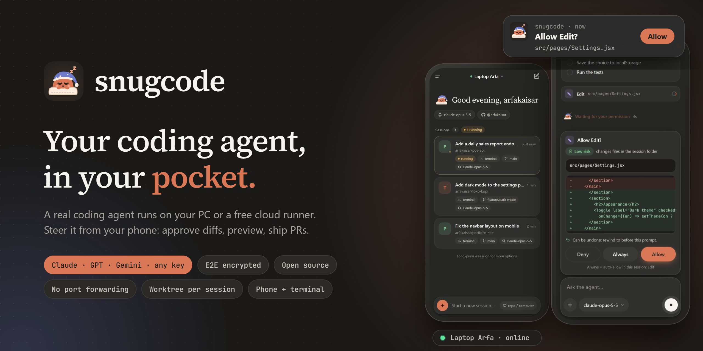

<div align="center">



**A coding agent that runs on your PC — or in the cloud without one — fully controlled from your phone.**

[Bahasa Indonesia (full docs)](README.md) · [Security model](docs/keamanan.md) · [Architecture](master.md)

</div>

## What it is

snugcode runs a coding agent on your own machine (or a GitHub Codespaces / Docker runner) and gives you a mobile
PWA to drive it: analyze a repo, edit code, run tests, preview your web app, commit, push, and open pull requests
from anywhere. Each model runs in the harness that suits it best — **Claude Agent SDK** for Claude and
Anthropic/OpenAI-compatible endpoints, the official **Codex** for GPT (including ChatGPT login), and **Gemini CLI**
for Gemini. Paste any API key (Anthropic, OpenAI, Gemini, OpenRouter, DeepSeek, Kimi, GLM, xAI, Groq, or a router)
and it is detected automatically.

- **Compute stays on your machine** — your toolchain, `node_modules`, Docker. The phone is a remote control.
- **No network setup** — PC and phone both connect *out* to a small Cloudflare relay. No VPN, ports, or ngrok.
- **End-to-end encrypted** — PIN pairing with PAKE (CPace / ristretto255), then XChaCha20-Poly1305 per message.
  The relay forwards ciphertext; [its limits are documented honestly](docs/keamanan.md) (it also serves the PWA
  code — you can verify the build or self-host the relay).
- **Safe for your repo** — every session works in its own `git worktree` and branch; every prompt can be rewound.
- **Risk-tiered permissions** — each request is labeled low/medium/high risk with a reason; pick an autonomy
  level (*Ask everything*, *Balanced*, *Routine automatic* — tests/lint/build run on their own — or *Full*).
  Push, PRs, and credential files always ask.
- **Cost guardrails** — per-turn and per-session cost, plus an optional session budget.
- **Approve from the notification** for low/medium-risk requests; terminal UI (`snugcode`) shares sessions with
  the phone.

## Install on your PC

Requires Node.js 22+, git, a GitHub account, and a ChatGPT account or a model API key.

```bash
# macOS / Linux
curl -fsSL https://snugcode.dev/install.sh | sh
```

```powershell
# Windows (PowerShell)
irm https://snugcode.dev/install.ps1 | iex
```

Then run `snugcode autostart on`, open **https://snugcode.dev** on your phone, sign in with the same
GitHub account, pick your PC, and enter the PIN once. No PC? Choose **cloud runner** after signing in.

The UI and full documentation are currently in Indonesian; see [README.md](README.md).

## License

[MIT](LICENSE)
