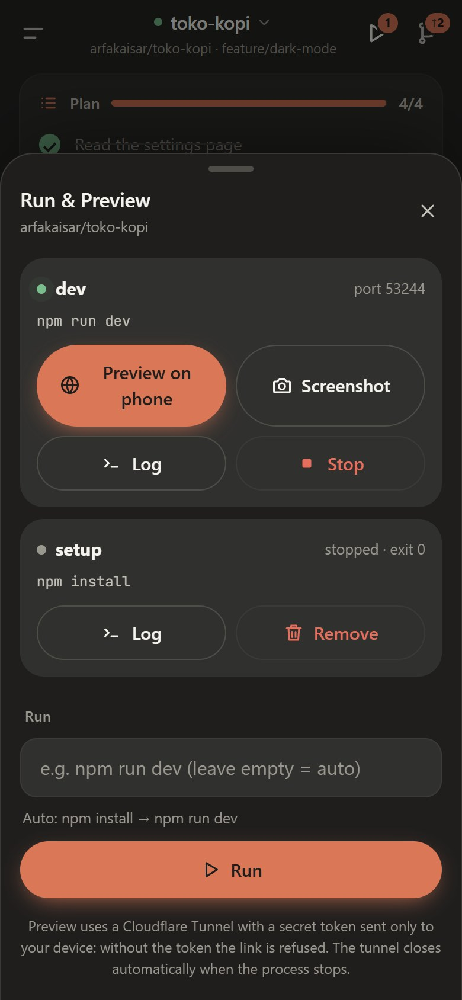
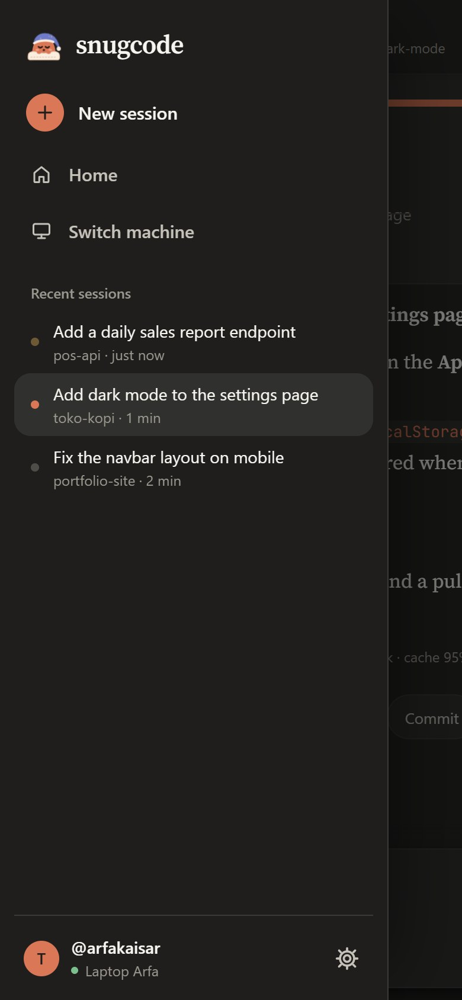
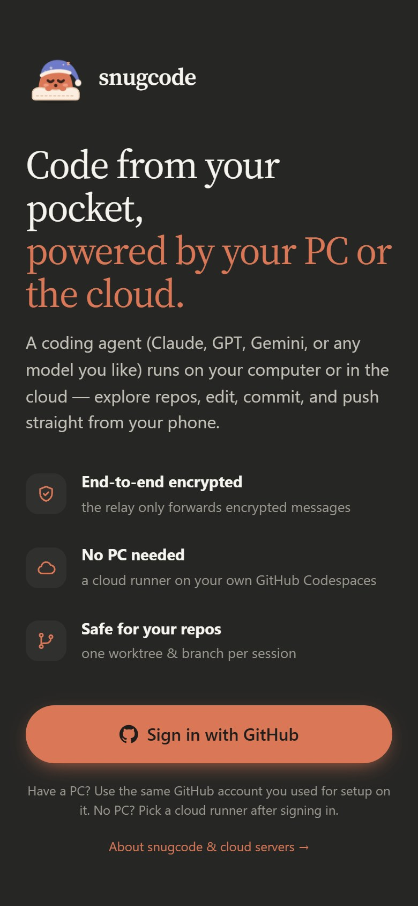
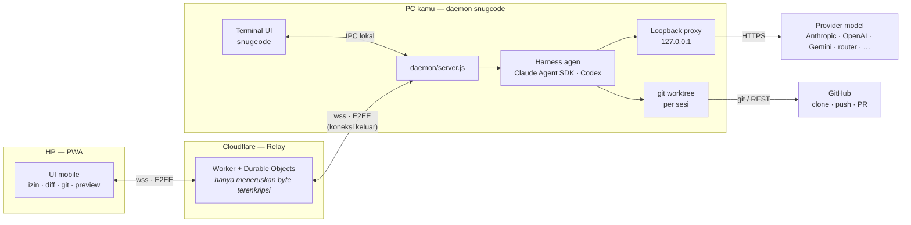
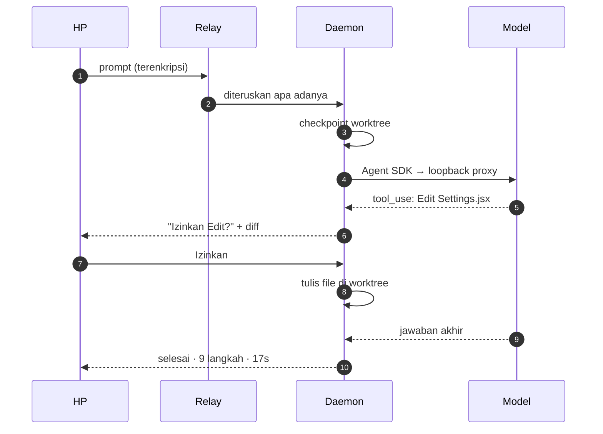
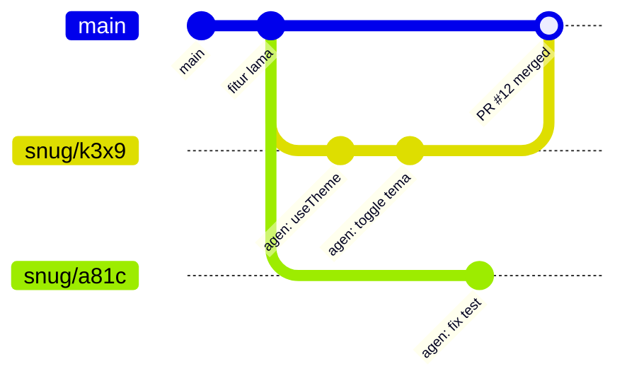
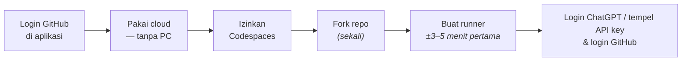
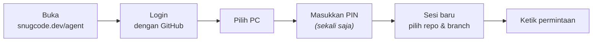
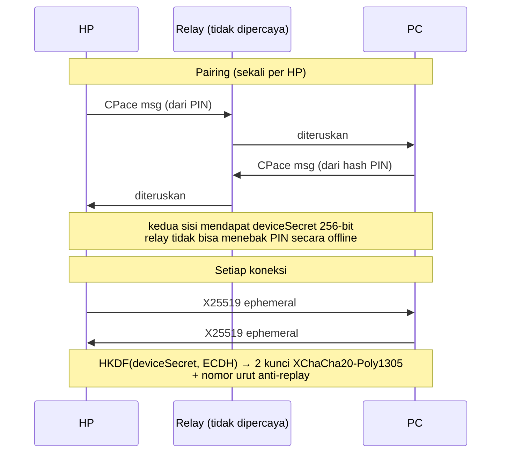
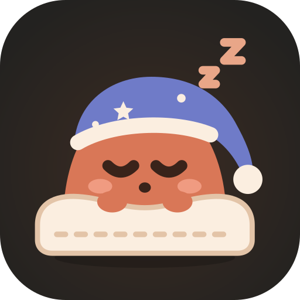

<div align="center">


<br>

**Coding agent yang berjalan di PC-mu — atau di cloud tanpa PC — dikendalikan penuh dari HP.**<br>
Login ChatGPT atau tempel API key apa pun (Claude, OpenAI, Gemini, OpenRouter, DeepSeek, router…): snugcode mendeteksinya dan menjalankan tiap model di harness terbaiknya.<br>
Analisis repo, edit kode, jalankan test, preview web app, commit, push, dan buat Pull Request dari mana saja.

<br>

[](https://nodejs.org)
[](#lisensi)
[](#keamanan)
[](#instalasi-di-pc)
[](#pakai-dari-hp)

**[Instalasi](#instalasi-di-pc)** &nbsp;·&nbsp; **[Tanpa PC](#tanpa-pc-runner-cloud)** &nbsp;·&nbsp; **[Model & API key](#model--api-key)** &nbsp;·&nbsp; [Demo](#lihat-cara-kerjanya) &nbsp;·&nbsp; [Fitur](#fitur) &nbsp;·&nbsp; [Arsitektur](#arsitektur) &nbsp;·&nbsp; [Terminal](#terminal-snugcode) &nbsp;·&nbsp; [Keamanan](#keamanan) &nbsp;·&nbsp; [FAQ](#faq)

<sub><a href="README.en.md">English</a> · Dulu bernama <b>pocketcode</b> — lihat <a href="#migrasi-dari-pocketcode">Migrasi dari pocketcode</a>.</sub>

</div>

<br>

## Lihat cara kerjanya

<table>
<tr>
<td width="58%" valign="top">


</td>
<td width="42%" valign="top">

### Dari prompt sampai test lulus

Ketik permintaan di HP. Agen di PC menyusun rencana, membaca kode, lalu meminta izin sebelum mengubah file — lengkap dengan diff-nya.

Setiap izin cukup **satu ketukan**. Perintah shell seperti `npm test` berjalan di PC-mu sendiri, dengan `node_modules`, toolchain, dan environment yang sudah ada.

Di akhir, ringkasan menampilkan jumlah langkah, durasi, token, porsi cache, dan biaya.

<sub>Rekaman layar aplikasi asli: PWA di Chromium terhadap daemon snugcode dan mock model.</sub>

</td>
</tr>
</table>

<table>
<tr>
<td width="50%" align="center" valign="top">
<br>
<b>Run & Preview</b><br>
<sub>Dev server jalan di PC, screenshot diambil Chrome di PC, error console langsung bisa diserahkan ke agen.</sub>
</td>
<td width="50%" align="center" valign="top">
<br>
<b>Git dari HP</b><br>
<sub>Status, diff berwarna per file, commit, push, dan Pull Request tanpa membuka laptop.</sub>
</td>
</tr>
</table>

<p align="center">
<br>
<b>Terminal UI</b> &nbsp;<code>snugcode</code><br>
<sub>Pengalaman seperti <code>claude</code> di terminal. Sesinya sama dengan yang di HP: mulai di meja, lanjutkan di jalan.</sub>
</p>

---

## Kenapa snugcode?

Coding agent seperti Claude Code sangat membantu, tapi kamu harus duduk di depan PC. **snugcode** memindahkan kendalinya ke HP, sementara semua pekerjaan berat tetap di PC.

<table>
<tr>
<td width="33%" valign="top">

**Compute tetap di PC**<br>
<sub>Kode, `node_modules`, Docker, compiler, dan build berjalan di komputermu. HP hanya remote control.</sub>

</td>
<td width="33%" valign="top">

**Tanpa setup jaringan**<br>
<sub>Tidak perlu VPS, IP publik, port forwarding, VPN, atau ngrok. PC dan HP sama-sama membuka koneksi *keluar* ke relay.</sub>

</td>
<td width="33%" valign="top">

**End-to-end encrypted**<br>
<sub>Pairing PIN dengan PAKE (CPace / ristretto255), lalu setiap pesan dienkripsi XChaCha20-Poly1305. Relay hanya meneruskan pesan terenkripsi — batasannya dijelaskan terbuka di <a href="docs/keamanan.md">docs/keamanan.md</a>.</sub>

</td>
</tr>
<tr>
<td valign="top">

**Kredensial tidak keluar dari PC**<br>
<sub>API key, login ChatGPT, dan token GitHub hanya tersimpan di `~/.snugcode` (di PC atau runner cloud-mu), tidak pernah dikembalikan ke HP, tidak terbaca relay, dan tidak terlihat oleh agen.</sub>

</td>
<td valign="top">

**Aman untuk repo-mu**<br>
<sub>Setiap sesi bekerja di `git worktree` dan branch sendiri. Branch utama tetap bersih sampai kamu memutuskan merge.</sub>

</td>
<td valign="top">

**Satu sesi, dua layar**<br>
<sub>Mulai di terminal PC, lanjutkan di HP, atau sebaliknya. Keduanya tersinkron secara real time.</sub>

</td>
</tr>
</table>

---

## Tampilan

Tangkapan layar mengikuti tema GitHub-mu: tema gelap atau terang.

<table>
<tr>
<td align="center" width="33%" valign="top">
<picture><source media="(prefers-color-scheme: light)" srcset="docs/images/sessions-light.jpg"></picture><br>
<b>Beranda</b><br><sub>Sesi dari HP & terminal, status, branch, model</sub>
</td>
<td align="center" width="33%" valign="top">
<picture><source media="(prefers-color-scheme: light)" srcset="docs/images/session-light.jpg"></picture><br>
<b>Izin dengan diff</b><br><sub>Rencana, tool yang berjalan, dan izin 1-tap</sub>
</td>
<td align="center" width="33%" valign="top">
<picture><source media="(prefers-color-scheme: light)" srcset="docs/images/summary-light.jpg"></picture><br>
<b>Ringkasan</b><br><sub>Rencana selesai, jawaban, token, cache & biaya</sub>
</td>
</tr>
<tr>
<td align="center" valign="top">
<picture><source media="(prefers-color-scheme: light)" srcset="docs/images/diff-light.jpg"></picture><br>
<b>Diff</b><br><sub>Perubahan per file, bisa dilipat</sub>
</td>
<td align="center" valign="top">
<picture><source media="(prefers-color-scheme: light)" srcset="docs/images/run-light.jpg"></picture><br>
<b>Run & Preview</b><br><sub>Dev server, log, preview lewat tunnel bertoken</sub>
</td>
<td align="center" valign="top">
<picture><source media="(prefers-color-scheme: light)" srcset="docs/images/preview-light.jpg"></picture><br>
<b>Screenshot</b><br><sub>Dirender Chrome di PC, plus error console</sub>
</td>
</tr>
<tr>
<td align="center" valign="top">
<picture><source media="(prefers-color-scheme: light)" srcset="docs/images/model-light.jpg"></picture><br>
<b>Model & effort</b><br><sub>Ganti model di tengah sesi, slider effort</sub>
</td>
<td align="center" valign="top">
<picture><source media="(prefers-color-scheme: light)" srcset="docs/images/drawer-light.jpg"></picture><br>
<b>Navigasi</b><br><sub>Sesi terbaru, ganti PC, akun & tema</sub>
</td>
<td align="center" valign="top">
<picture><source media="(prefers-color-scheme: light)" srcset="docs/images/login-light.jpg"></picture><br>
<b>Login</b><br><sub>Masuk dengan GitHub, pairing PIN sekali</sub>
</td>
</tr>
</table>

<sub>Semua gambar dibuat ulang dengan `npm run docs:images` (lihat [`scripts/docs-images.mjs`](scripts/docs-images.mjs)) dari UI asli dengan repo contoh. Hero dan terminal dirender dari [`docs/mockups/`](docs/mockups).</sub>

---

## Fitur

<table>
<tr>
<td width="50%" valign="top">

#### Agen & kolaborasi

- **Harness terbaik per model** — model Claude & endpoint format Anthropic/OpenAI berjalan di **Claude Agent SDK**, model GPT (login ChatGPT / OpenAI) di **Codex** resmi, model Gemini (API key Google AI) di **Gemini CLI** resmi. Pilihan bawaan bisa diukur ulang dengan `npm run bench`. Lihat [Model & API key](#model--api-key).
- **Tempel API key apa pun** — Anthropic, OpenAI, Gemini, OpenRouter, DeepSeek, Kimi, GLM, xAI, Groq, atau router (9router, OmniRoute, LiteLLM, lokal); jenis & formatnya dideteksi otomatis. Konfigurasi agen dirampingkan: setiap request ±55% lebih kecil.
- **Subagen hemat** — Explore, Plan, dan lainnya otomatis memakai model ringan dari koneksi yang sama (**Claude Haiku**, **Gemini Flash**, …) dengan effort rendah.
- **Izin 1-tap** — *Izinkan / Selalu / Tolak*. *Selalu* berlaku per pola perintah (mis. `npm test *`), bukan untuk semua Bash.
- **Edit langsung diterapkan** di worktree sesi dan bisa di-rewind. Nyalakan *Tinjau edit* (`/edits`) untuk menyetujui setiap diff.
- **Auto-izin** untuk kerja mandiri; `git push` dan `gh pr create` tetap selalu meminta izin.
- **Mode rencana** — agen membaca lalu mengajukan rencana untuk disetujui atau direvisi.
- **Agen bisa bertanya** — pertanyaan pilihan dijawab dengan sekali tap.
- **Kirim gambar** dari kamera atau galeri (maks. 4 per pesan).
- **Checkpoint & rewind** ke kondisi sebelum prompt mana pun.
- **Review diff per hunk** — komentari baris atau hunk lalu kirim sebagai satu pesan ke agen, atau batalkan satu hunk/file.
- **Shell langsung** — `!npm test`, `!git status`, output di-stream ke HP.
- **Mode Komputer** — sesi tanpa repo/worktree yang bisa membaca, mengedit, dan menjalankan perintah di seluruh PC, seperti `claude` biasa. Lihat [Mode Komputer](#mode-komputer).

</td>
<td width="50%" valign="top">

#### Run & Preview

- **Dev server di latar belakang** — perintah setup/dev terdeteksi otomatis (npm / pnpm / yarn / …), log live, deteksi port.
- **Preview di HP** lewat tunnel pribadi bertoken; HMR Vite/Next tetap berjalan.
- **Screenshot + error console** dari Chrome/Edge headless di PC, lalu *Suruh agen perbaiki*.
- **Terminal interaktif** (PTY) di HP — `vim`, `htop`, REPL, prompt login; baris tombol Esc/Tab/Ctrl/panah, sampai 4 tab per sesi. Shell tetap hidup saat layar ditutup.
- **File explorer** — telusuri worktree, baca & edit file (dengan deteksi konflik), buat file baru, *Tanya agen* tentang file.
- Agen bisa **melihat hasil UI-nya sendiri** (`dev_start`, `preview_screenshot`) untuk verifikasi.

#### Git & GitHub

- Clone repo GitHub-mu ke PC, satu worktree dan branch per sesi.
- Status, diff, commit, push, dan **Pull Request** dari HP.

#### Sistem

- **Web Push** saat agen selesai, butuh izin, atau bertanya — juga saat PWA ditutup.
- **Anti-sleep** selama daemon berjalan di PC (Away Mode / `caffeinate` / `systemd-inhibit`).
- **Update jarak jauh 1-tap** dari HP, dengan banner saat ada versi baru.
- **Setelan PC dari HP** — model & API key, login ChatGPT, perangkat terpasang, PIN, dan login GitHub, tanpa terminal.
- **Progress yang jelas** untuk proses lama (membuat runner, update, clone, push): tahap, waktu berjalan, dan perkiraan sisa.
- **Pemilih model** dengan slider effort (`low → max`) dan uji kesehatan model otomatis.
- **Tema gelap & terang**, mengikuti sistem atau dipilih manual.

</td>
</tr>
</table>

---

## Arsitektur



1. **Daemon** berjalan di latar belakang PC (otomatis saat login) dan membuka WebSocket *keluar* ke relay.
2. **HP** membuka PWA, login GitHub, lalu memasangkan diri dengan PC memakai **PIN** (cukup sekali).
3. Setiap prompt dari HP dikirim terenkripsi ke PC, lalu harness yang cocok untuk modelnya (**Claude Agent SDK** atau **Codex**) mengerjakannya di worktree sesi.
4. Event agen (teks, tool, permintaan izin) di-stream balik ke HP **dan** ke terminal secara real time.

<details>
<summary><b>Alur satu prompt</b></summary>


</details>

<details>
<summary><b>Isolasi sesi dengan git worktree</b></summary>



Setiap sesi mendapat folder `~/.snugcode/workspaces/<owner>__<repo>/s-<id>` dengan branch sendiri (default `snug/<id>`). Beberapa sesi bisa berjalan paralel di repo yang sama tanpa saling ganggu.
</details>

---

## Tanpa PC: runner cloud

Tidak punya PC yang bisa terus menyala? Semua bisa dari HP: daemon snugcode yang **sama** berjalan di
**GitHub Codespaces milikmu**, dan aplikasi memperlakukannya seperti PC biasa. Tidak ada yang perlu
dipasang atau diketik di komputer mana pun.



1. Login di aplikasi → layar kosong menampilkan **Pakai cloud — tanpa PC** (atau *Tambah PC lain* → *Buat runner cloud*).
2. **Hubungkan GitHub Codespaces** (izin `codespace`; token hanya disimpan di HP, tidak di server snugcode).
3. Fork repo ini sekali. Codespace runner dibuat dari fork itu.
4. **Buat runner**: aplikasi mendaftarkan mesin, menyimpan token mesin & PIN acak sebagai *Codespaces secret*
   yang **dienkripsi di HP** (sealed box), lalu membuat codespace. HP langsung terpasang tanpa mengetik PIN.
5. **Login ChatGPT** atau tempel **API key** (dideteksi & diuji dulu sebelum disimpan), lalu login GitHub untuk clone/push — semuanya dari HP.

Selama runner disiapkan, aplikasi menampilkan tahap nyata dari codespace (menyiapkan mesin → Chromium → memasang
snugcode → menyalakan) beserta perkiraan sisa waktu. Bila skrip runner gagal, pesan error dan baris log terakhirnya
dikirim ke HP, jadi kamu tidak perlu membuka terminal codespace.

| | |
|---|---|
| **Biaya** | Kuota gratis GitHub: 120 core-hour/bulan untuk akun Free (±60 jam runner 2-core), 180 untuk Pro. Perkiraan pemakaian bulan ini tampil di menu runner (dicatat runner sendiri; billing GitHub tidak bisa dibaca dengan izin `codespace`). |
| **Lebih cepat** | Opsional: atur **prebuild** di setelan Codespaces fork-mu — runner baru menyala ±1 menit, bukan 3–5 menit. Lihat [`.devcontainer/README.md`](.devcontainer/README.md#prebuild-opsional-runner-baru-lebih-cepat). |
| **Berhenti sendiri** | Setelah 30 menit tidak dipakai (bisa 15 menit – 2 jam, atau mati) — tidak ada agen/perintah/dev server berjalan dan aplikasi tidak dibuka. |
| **Menyala lagi** | Otomatis saat kamu membuka runner di aplikasi (±30–60 detik). Sesi, worktree, dan riwayat tetap ada di `/workspaces/.snugcode`. |
| **Fitur** | Sama dengan PC: agen, izin, Run & Preview (Chromium terpasang), git/PR, Web Push, update jarak jauh. |
| **Batas** | Satu runner Codespaces dari wizard (bisa *Buat ulang*), maksimal 3 mesin cloud per akun. |
| **Hapus** | Tombol ⋯ di daftar mesin (juga saat offline/macet): codespace, secret, dan mesinnya ikut dihapus. |

Izin Codespaces di HP dicabut atau kedaluwarsa? Aplikasi menawarkan **Hubungkan lagi GitHub Codespaces**; runner
dan isinya tidak berubah.

**Server sendiri (Docker / VPS):** di wizard yang sama, *Server sendiri* membuat perintah `docker build … && docker run …`
lengkap dengan token mesin & PIN (lihat [`Dockerfile`](Dockerfile)). Untuk penyedia lain, jalankan `snugcode cloud`
dengan env dari [`daemon/runner.js`](daemon/runner.js).

> [!NOTE]
> Di mode cloud, kode dan API key berada di mesin penyedia runner (GitHub, atau servermu). Pesan tetap E2EE,
> dan PIN maupun key tidak pernah lewat relay dalam bentuk terbaca.

---

## Model & API key

Buka **Pengaturan PC → Model & API key** di aplikasi (atau `snugcode connect` di terminal), lalu pilih salah satu:

- **Login dengan ChatGPT** — langganan Plus/Pro dipakai lewat **Codex** resmi (OpenAI mengizinkannya untuk harness pihak ketiga). Kode login tampil di HP; selesaikan di browser.
- **Tempel API key** — jenisnya dikenali dari bentuknya dan diverifikasi ke provider; key yang tidak dikenali dianggap key router dan diminta URL-nya.

| Key / endpoint | Contoh | Harness yang dipakai |
|---|---|---|
| Anthropic (Claude API) | `sk-ant-api03-…` | Claude Agent SDK, langsung ke `api.anthropic.com` (prompt cache native) |
| OpenAI | `sk-proj-…` | Codex (Responses API) |
| Google Gemini API | `AIza…` | **Gemini CLI** resmi (ACP, format API asli; dipasang otomatis sekali). Bila Gemini CLI tidak bisa dipasang: Claude Agent SDK + penerjemah format di proxy |
| OpenRouter | `sk-or-v1-…` | Claude Agent SDK lewat endpoint format Anthropic-nya (atau penerjemah) |
| DeepSeek · Kimi · GLM | `sk-…` · `….…` | Claude Agent SDK lewat endpoint format Anthropic resmi mereka |
| xAI · Groq | `xai-…` · `gsk_…` | Claude Agent SDK + penerjemah format |
| Router / endpoint sendiri (9router, OmniRoute, LiteLLM, Ollama, …) | key + URL | dideteksi: format Anthropic → Claude Agent SDK; model GPT + Responses API → Codex; hanya OpenAI Chat → penerjemah |

Semua koneksi tampil bersama di pemilih model (dikelompokkan per koneksi, dengan slider effort bila modelnya mendukung). Model yang sama bisa dipakai lewat beberapa koneksi; harness dipilih per model ([`shared/engine-table.js`](shared/engine-table.js), lalu format endpoint), dan bisa dipaksa dengan env `SNUGCODE_ENGINE=claude|codex|gemini` (bila endpoint-nya mendukung).

**Mengukur harness terbaik:** `npm run bench -- --models gemini:gemini-3.8-flash,openai:gpt-5.5` menjalankan tugas coding kecil yang sama (perbaiki bug, fitur baru, rename lintas file) di tiap engine untuk tiap model, menilainya dengan test, lalu mencetak tabel tingkat lulus, waktu, dan token beserta saran baris `engine-table.js`. Memakai koneksi & key di PC ini (token ditagihkan ke key-mu), di folder data sementara.

> [!IMPORTANT]
> **Langganan Claude Pro/Max** dan **login Gemini CLI / Antigravity** tidak boleh dipakai aplikasi pihak ketiga (ketentuan Anthropic & Google, 2026 — akun bisa diblokir/disuspend). snugcode menolak token langganan Claude dan memakai API key. Router yang meneruskan langganan semacam itu (mis. provider `cc/` atau `ag/` di 9router) tetap bisa disambungkan, tapi risikonya ada di akunmu.

```bash
snugcode connect sk-ant-api03-…              # API key apa pun, jenisnya dideteksi
snugcode connect rk-… --url https://router.contoh.com/v1   # router / endpoint sendiri
snugcode connect chatgpt                     # login ChatGPT (Codex), kode bisa dibuka di HP
snugcode connect                             # daftar koneksi;  snugcode disconnect <id>
```

Runner cloud/Docker: `SNUGCODE_API_KEY` (+ `SNUGCODE_API_URL` untuk router) menyambungkan model saat start.

---

## Instalasi di PC

**Kebutuhan:** [Node.js 22+](https://nodejs.org), [git](https://git-scm.com), akun GitHub, dan **akun ChatGPT atau API key model** (lihat [Model & API key](#model--api-key)).

Cara tercepat — pemasang satu baris memeriksa Node.js & git, memasang snugcode, lalu menjalankan setup:

```bash
# macOS / Linux
curl -fsSL https://snugcode.dev/install.sh | sh
```

```powershell
# Windows (PowerShell)
irm https://snugcode.dev/install.ps1 | iex
```

Perintah yang sama ada di aplikasi HP (*Tambah PC* → salin), dan HP otomatis membuka PC baru begitu setup selesai.
Atau manual:

```bash
npm i -g github:arfakaisar/snugcode
snugcode setup
snugcode autostart on
```

`snugcode setup` akan menanyakan:

1. **API key** apa pun — jenisnya dideteksi otomatis; key router (9router, OmniRoute, …) beserta URL-nya — lalu model utama (model ringan subagen dipilih otomatis). Login ChatGPT: `snugcode connect chatgpt` atau dari HP.
2. **Cara login GitHub** untuk clone, push, dan PR. Disarankan *login lewat browser/HP*.
3. **Nama PC** dan **PIN** (6–12 huruf/angka, tidak peka huruf besar/kecil, misal `moon42`).
4. Lalu tampil **satu link** (menautkan PC ke akun GitHub-mu) dan **satu kode** (login GitHub untuk PC). Keduanya boleh dibuka dari HP.

`snugcode autostart on` menjalankan daemon di latar belakang sekarang juga, dan otomatis setiap kali login ke Windows, macOS, atau Linux.

> [!TIP]
> Tanpa install global: `npx github:arfakaisar/snugcode setup`, lalu `npx github:arfakaisar/snugcode start`.

> [!NOTE]
> PC harus menyala selama dipakai dari HP. snugcode meminta OS agar tidak tidur selama daemon berjalan, tapi kalau PC tetap tertidur karena idle, ubah pengaturan sleep: di Windows, Settings → System → Power → Sleep: *Never* (saat dicolok).

---

## Pakai dari HP



1. Buka **https://snugcode.dev/agent/** di browser HP (atau tombol **Buka snugcode agent** di landing page snugcode.dev), lalu **Login dengan GitHub** (akun yang sama dengan setup PC).
2. Pilih PC, lalu masukkan PIN.
3. Menu browser → **Add to Home screen**, supaya terbuka layar penuh seperti aplikasi dan notifikasi push berjalan (wajib di iOS).
4. Akun → **Izinkan notifikasi**. Izin berisiko rendah/sedang bisa langsung dijawab dari tombol *Izinkan / Tolak* di notifikasi (Android & desktop); pilih *Kabar yang dikirim → Penting saja* bila hanya ingin diberi tahu soal izin, pertanyaan, dan tugas selesai.

### Kontrol di layar sesi

| Kontrol | Fungsi |
|---|---|
| Tombol menu (kiri atas) atau geser dari tepi kiri | Drawer: sesi baru, beranda, sesi terbaru, ganti PC, akun & tema |
| **Judul sesi** | Menu sesi: rincian branch/model, git, run, **File**, **Terminal**, ganti model, simpan `.env`, hapus sesi |
| Ikon *play* (kanan atas) | Run & Preview: dev server, log, screenshot, link preview |
| Ikon *branch* (kanan atas) | Git: status, diff (komentar per baris/hunk → *Kirim ke agen*, batalkan hunk/file), commit, push, Pull Request (badge = jumlah file berubah) |
| **+** di composer | Lampiran & alat: kamera, galeri, mode rencana, mode shell, **otonomi agen**, aksi cepat & prompt tersimpan |
| **Nama model** di composer | Ganti model & effort di tengah sesi (berlaku mulai pesan berikutnya) |
| Pil mode di atas input | Mode yang aktif (Rencana / Shell / Auto-izin); ketuk untuk mematikan |
| `!` di awal pesan | Jalankan sebagai perintah shell |
| **rewind** di bawah pesanmu | Kembalikan semua file ke sebelum prompt itu |
| Chip di bawah ringkasan selesai | Langkah berikutnya sekali ketuk: jalankan test, review, commit |
| Menu sesi → **Biaya & batas** | Biaya sesi (perkiraan) dan batas biaya: prompt ditahan saat batas tercapai |
| Tombol stop | Hentikan agen |
| Tekan lama sesi (beranda) | Buka / hapus sesi |
| Tarik ke bawah (daftar) | Muat ulang |

### Model & effort

- Varian effort yang di router berupa ID terpisah (misal `ag/gemini-3.8-flash-low` / `-medium` / `-high`) digabung jadi **satu model dengan slider effort**.
- Model Claude (`cc/claude-opus-5-5`, `cc/claude-sonnet-5-5`) mendapat slider virtual *auto · low · medium · high · max*.
- Ganti model/effort di tengah sesi langsung berlaku di proses agen yang sama (tanpa restart).
- **Model ringan (subagen)** dipilih otomatis: model utama Claude (`cc/`) → Claude Haiku 5.5, lalu Gemini 3.8 Flash; model lain (`ag/`, …) → Gemini 3.8 Flash, lalu Claude Haiku 5.5. Bila keduanya tidak ada di router, subagen memakai model utama.
- Ringkasan selesai menampilkan **cache %**: porsi input yang dibaca dari prompt cache. Selalu 0% berarti provider/router tidak meng-cache, sehingga setiap langkah ditagih penuh.
- Setiap model yang dipilih **diuji otomatis** dengan satu pesan kecil, untuk menangkap model yang sudah dihentikan tapi masih membalas "sukses".
- Hanya model yang mendukung tool calling yang ditampilkan.

### Run & Preview

Ketuk ikon *play* di kanan atas → **Jalankan**. Perintah setup (`npm ci`, `pnpm install`, …) dan dev (`npm run dev`, …) terdeteksi otomatis, atau bisa ditetapkan per repo lewat `.snugcode.json`:

```json
{ "setup": "pnpm install", "dev": "pnpm dev --port {port}" }
```

Env `PORT` diisi port bebas, dan `{port}` diganti dengan port yang sama. **Preview di HP** membuka Cloudflare quick tunnel ke gerbang lokal yang dilindungi token rahasia (dikirim hanya lewat kanal E2EE). Tanpa token, link ditolak. Tunnel tertutup otomatis saat proses berhenti.

> [!TIP]
> File `.env` tidak ikut di worktree baru. Buka menu sesi → **Simpan .env sebagai template**, maka file itu dipulihkan otomatis di setiap sesi baru repo yang sama.

### Mode Komputer

**Sesi baru** punya dua tab: **Repository** (clone + worktree terisolasi, seperti di atas) dan **Komputer**. Sesi
Komputer berjalan di folder mana pun yang kamu pilih (bawaan: home `~`) tanpa clone, tanpa worktree, dan tanpa
branch baru. Agen boleh membaca dan mengedit file di seluruh PC, seperti `claude` biasa di terminal.

- Baca dan edit file di mana pun langsung diterapkan; perintah Bash yang tidak read-only tetap meminta izin (kecuali auto-izin).
- **Tidak ada checkpoint & rewind**, dan template `.env` tidak tersedia. Git hanya menampilkan status/diff bila folder kerjanya repo git.
- Folder data `~/.snugcode` tetap tertutup untuk agen, dan `git push` / `gh pr create` tetap selalu meminta izin.
- Menghapus sesi Komputer hanya menghapus riwayatnya; file di PC tidak disentuh.
- Dari terminal: `snugcode --computer` (atau `-c`), atau `/computer` di dalam TUI.

> [!WARNING]
> Mode Komputer sengaja tidak terisolasi. Pakai untuk tugas sistem (merapikan file, konfigurasi, skrip lintas
> folder); untuk mengubah kode repo, sesi Repository lebih aman karena bisa di-rewind.

---

## Terminal: `snugcode`

```bash
cd proyek-kamu
snugcode                     # atau singkatnya: snug
snugcode "jelaskan repo ini" # langsung kirim prompt
snugcode --pick              # pilih sesi lain (termasuk sesi dari HP)
snugcode --computer          # sesi Mode Komputer di folder ini (akses seluruh PC)
```

- Folder repo git tempat kamu menjalankan `snugcode` langsung menjadi sesinya, tanpa clone. Sesi terakhir di folder itu otomatis dilanjutkan.
- **Sesi di terminal dan di HP adalah sesi yang sama.** Sesi dari terminal ditandai "terminal" di aplikasi HP.
- Daemon dinyalakan otomatis kalau belum berjalan.

| Tombol | Fungsi |
|---|---|
| `enter` | kirim; saat agen bekerja, pesan masuk antrean |
| `\` + `enter` / `alt+enter` | baris baru |
| `!` | mode shell (perintah langsung di folder sesi) |
| `/` | perintah: `/model` `/default` `/sessions` `/new` `/computer` `/run` `/preview` `/logs` `/plan` `/rewind` `/git` `/diff` `/commit` `/push` `/pr` `/auto` `/edits` `/login` `/update` `/clean` `/help` … |
| `esc` | hentikan agen |
| `ctrl+o` | output lengkap tool terakhir |
| `ctrl+c` ×2 | keluar (sesi tetap berjalan di PC) |

Di `/model`, gunakan ↑↓ untuk memilih model dan ←→ untuk mengatur effort.

### Perintah CLI

| Perintah | Fungsi |
|---|---|
| `snugcode` / `snug` | UI terminal |
| `snugcode --computer` / `-c` | UI terminal dengan sesi Mode Komputer |
| `snugcode setup` | Setup / ubah konfigurasi |
| `snugcode login` | Login ulang GitHub saja |
| `snugcode connect <key> [--url URL]` | Sambungkan API key model (jenis dideteksi otomatis) |
| `snugcode connect chatgpt` | Login ChatGPT untuk model GPT (Codex) |
| `snugcode connect` / `disconnect <id>` | Daftar / hapus koneksi model |
| `snugcode start` | Jalankan daemon di terminal ini |
| `snugcode stop` / `restart` | Hentikan / restart daemon latar belakang |
| `snugcode update` | Periksa dan pasang pembaruan (rilis bertag; `--channel main` untuk commit terbaru) |
| `snugcode update --rollback` | Kembali ke versi sebelum pembaruan terakhir |
| `snugcode autostart on\|off` | Jalankan di latar belakang + otomatis saat login |
| `snugcode clean` | Pindai & bersihkan worktree / repo yatim |
| `snugcode pin` | Ganti PIN dan buka kunci pairing sekarang juga (lalu `snugcode restart`) |
| `snugcode devices` | Daftar HP yang sudah dipasangkan |
| `snugcode revoke <id\|all>` | Cabut akses HP (lalu `snugcode restart`; dari HP langsung berlaku) |
| `snugcode status` | Ringkasan konfigurasi |
| `snugcode keychain on\|off\|status` | Enkripsi `secrets.json` dengan kunci di keychain OS (macOS Keychain, Secret Service, DPAPI) |
| `snugcode cloud` | Runner cloud tanpa PC (Codespaces/Docker): konfigurasi dari env, setelan lain dari HP |
| `snugcode help` | Daftar perintah |

Model & API key, PIN, dan perangkat juga bisa diatur dari HP: **Pengaturan PC → Model & akses**.

<details>
<summary><b>Lokasi data di PC</b></summary>

Semua data disimpan di `~/.snugcode` (bisa diganti dengan env `SNUGCODE_HOME`). Instalasi lama yang sudah punya `~/.pocketcode` tetap memakai folder itu:

```
~/.snugcode/
├── config.json          # nama PC, relay, model default, …
├── secrets.json         # koneksi model (API key), token GitHub, PIN (hash), device secret HP (terenkripsi bila `snugcode keychain on`)
├── daemon.log           # log daemon latar belakang (daemon.pid, daemon.sock: proses & kanal terminal)
├── workspaces/
│   └── <owner>__<repo>/
│       ├── _base/       # clone dasar (disimpan 3 hari setelah sesi terakhirnya dihapus)
│       └── s-<id>/      # worktree per sesi
├── sessions/            # index.json + riwayat event per sesi (JSONL)
├── env/                 # template .env per repo
├── bin/                 # cloudflared (diunduh otomatis), shim pnpm/yarn di bin/pm
├── tools/               # corepack, Codex, Gemini CLI (masing-masing dipasang sekali saat pertama dibutuhkan)
├── claude/              # CLAUDE_CONFIG_DIR engine Claude, terpisah dari Claude Code pribadimu (termasuk plans/)
├── codex/               # CODEX_HOME engine Codex: login ChatGPT & riwayat thread (Codex dipasang di tools/codex)
└── gemini/              # GEMINI_CLI_HOME engine Gemini CLI (repo/ & computer/): setelan, instruksi, riwayat sesi
```

Di runner Codespaces folder ini adalah `/workspaces/.snugcode` (bertahan saat codespace berhenti), ditambah
`cloud.log`, `install.log`, dan `runner-usage.json` (perkiraan core-jam). Di container Docker: volume `/data`.
</details>

---

## Keamanan



- **Relay tidak membaca isi pesan** — PIN, isi percakapan, kode, API key, login ChatGPT, dan token GitHub tidak pernah lewat relay dalam bentuk terbaca. Lalu lintas model langsung dari mesinmu ke provider. **Batasan penting:** relay juga menyajikan kode PWA, jadi pihak yang menguasai deploy relay bisa mengganti kode itu. Baca [docs/keamanan.md](docs/keamanan.md) untuk model ancaman lengkap, cara memverifikasi build PWA (`build.json`), dan cara self-host relay.
- **Brute-force dibatasi** — setelah 5 kali PIN salah, pairing terkunci 15 menit (berlipat dua tiap kunci berikutnya, maks ±16 jam). `snugcode pin` di PC atau Ganti PIN dari HP lain membukanya langsung.
- **Login relay bisa dicabut** — Akun → *Keluar dari semua perangkat* mencabut token login di semua HP & browser (mis. HP hilang). Menautkan PC lewat link selalu meminta konfirmasi setelah login GitHub (nama PC, kode, dan akun tampil; konfirmasi lewat POST bertoken, tidak bisa dilewati dengan parameter URL). Login yang dipakai rutin diperpanjang otomatis.
- **PWA dengan CSP ketat** — tanpa skrip inline maupun skrip/font pihak ketiga (font di-host sendiri), dan WebSocket hanya ke relay sendiri, sehingga token & secret perangkat di HP lebih sulit dicuri lewat XSS. Token login dikirim lewat subprotocol WebSocket, bukan URL (tidak tercatat di log).
- **Kartu izin bertingkat risiko** — setiap permintaan diberi label risiko rendah/sedang/tinggi beserta alasannya; risiko tinggi (hapus data, skrip dari internet, push, keluar folder sesi) tampil merah tanpa tombol *Selalu*, dan tidak bisa dijawab dari tombol notifikasi.
- **Otonomi bertingkat** — *Tanya semua*, *Seimbang* (bawaan), *Rutin otomatis* (test/lint/build tanpa rangkaian perintah lolos sendiri), *Penuh* (auto-izin). Push, PR, dan file kredensial selalu bertanya di semua tingkat.
- **Binary yang diunduh diverifikasi** — Codex & Gemini CLI dipatok versinya; `cloudflared` dipatok versi + SHA-256 resmi ([`daemon/cloudflared-version.json`](daemon/cloudflared-version.json)).
- **Token GitHub** disuntikkan lewat env hanya ke perintah git milik daemon. Token tidak ditulis ke `.git/config` dan tidak terlihat oleh agen. `GITHUB_TOKEN`/`GH_TOKEN` yang ada di environment (mis. dari Codespaces) dibuang saat daemon start, jadi tidak terwariskan ke agen, Bash, dev server, atau `!perintah`.
- **Setelan dari HP** — model & API key, login ChatGPT, PIN, dan daftar HP bisa diatur dari aplikasi (Pengaturan PC). Key dikirim lewat kanal E2EE, divalidasi ke endpoint-nya dulu, dan tidak pernah dikembalikan ke klien.
- **API key tidak pernah masuk ke proses agen.** Proses `claude` / Codex (dan perintah agen) hanya memegang token lokal acak per koneksi; loopback proxy (`127.0.0.1`) menukarnya dengan key asli. Request tanpa token itu ditolak, jadi program lain di PC tidak bisa memakai key-mu.
- **`~/.snugcode` tertutup untuk agen** — Read/Write/Edit/Glob/Grep ke folder data (key, token, secret perangkat, template `.env`) selalu ditolak, juga saat auto-izin. Pengecualian hanya worktree sesi dan folder config Claude milik agen sendiri. Perintah Bash yang menyebut `secrets.json` selalu meminta izin.
- **Sandbox OS untuk auto-izin (engine Claude)** — saat ⚡ auto-izin aktif, Bash agen berjalan di sandbox Claude Code (bubblewrap + socat di Linux, Seatbelt di macOS) yang menolak membaca folder data snugcode dan menulis hook/config git; worktree, cache paket, dan jaringan tetap bisa dipakai. Perintah yang minta keluar dari sandbox selalu bertanya. `localhost` milik PC tidak terjangkau dari dalam sandbox (pakai `dev_*`/Preview untuk dev server). Atur lewat `"sandbox": "auto" | "always" | "off"` di `config.json` (atau `SNUGCODE_SANDBOX`). Bila bubblewrap/socat belum terpasang (`sudo apt install bubblewrap socat`) atau Windows, sesi memberi tahu bahwa auto-izin berjalan tanpa sandbox.
- **Tanpa izin hanya yang aman** — tool baca lolos otomatis hanya di dalam worktree sesi. Membaca di luar worktree dan `WebFetch` meminta izin (atau auto-izin), agar prompt injection dari README/issue tidak bisa diam-diam mengirim file ke luar.
- **Sandbox OS untuk engine Codex** — perintah agen Codex berjalan di sandbox (bubblewrap/Seatbelt) yang menolak membaca folder data snugcode (`secrets.json`, login ChatGPT, template `.env`, riwayat); jaringan tetap boleh. Setiap perintah tetap lewat kebijakan izin snugcode yang sama. Bila sandbox OS tidak tersedia (container tanpa user namespace), aplikasi memberi tahu dan izin tetap berlaku.
- **Aksi ke remote** (`git push`, `gh pr create|merge`, `gh repo create|delete`, …) selalu meminta izin, juga saat auto-izin aktif.
- **Mode Komputer** melonggarkan batas worktree: baca & edit di seluruh PC lolos tanpa bertanya (Bash yang tidak read-only tetap bertanya). Folder data snugcode dan aksi ke remote tetap dijaga seperti di atas.

- **Konfigurasi tool dari repo tidak dipercaya** — `.claude/settings.json` milik repo (hook, aturan izin, env, `apiKeyHelper`) **tidak** dimuat; hanya `CLAUDE.md` (dan `.claude/CLAUDE.md`) yang dibaca sebagai instruksi proyek. Mengubah `.claude/`, `.codex/`, `.gemini/`, `.mcp.json`, atau isi `.git/` selalu meminta izin, juga saat auto-izin, agar prompt injection tidak bisa memasang hook diam-diam.
- **Engine Gemini CLI** — folder kerja tidak pernah ditandai tepercaya, jadi `.gemini/settings.json` milik repo (server MCP, hook, `discoveryCommand`) tidak dijalankan; `GEMINI.md`/`AGENTS.md`/`CLAUDE.md` disisipkan snugcode sebagai instruksi. Gemini CLI tidak punya sandbox OS di Linux/Windows, jadi **perintah shell tetap bertanya walau auto-izin aktif**; edit file lewat snugcode (folder data ditolak, menunggu checkpoint).
- **`secrets.json` terenkripsi (opsional)** — `snugcode keychain on` mengenkripsi isinya (XChaCha20-Poly1305) dengan kunci yang hanya ada di keychain OS. Backup, sinkronisasi cloud, atau disk yang dipinjam tidak membuka API key & token. Ini perlindungan saat diam: proses milik user yang sama yang boleh membuka keychain tetap bisa, jadi batas agen tetap kebijakan izin & sandbox.
- **File explorer & terminal dari HP** — hanya di dalam folder sesi (folder data snugcode ditolak, symlink keluar disembunyikan); menyimpan file yang sudah berubah di PC ditolak (konflik hash). Terminal PTY berjalan sebagai user PC tanpa sandbox — sama seperti membuka terminal di PC itu, hanya lewat kanal E2EE.

> [!WARNING]
> Deteksi perintah push berbasis pola teks: ini pengaman dari kekeliruan agen, bukan sandbox. Di luar auto-izin, Bash berjalan tanpa sandbox setelah kamu menyetujuinya — baca perintahnya sebelum mengizinkan.

---

## Struktur repo

```
snugcode/
├── daemon/      # CLI, daemon, sesi Agent SDK, proxy, git, TUI, run & preview, updater
├── relay/       # Cloudflare Worker + Durable Objects (Hub, Pending) + worker alias alamat publik
├── web/         # PWA (vanilla JS, tanpa framework)
├── shared/      # kriptografi (CPace, X25519, XChaCha20), model event & normalisasi model
├── scripts/     # build PWA ke relay, ikon, gambar dokumentasi
├── test/        # unit, pengaman (hardening), integrasi worktree, e2e HP/relay/UI, runner cloud
├── .devcontainer/  # runner Codespaces (`snugcode cloud` saat codespace menyala)
├── .github/workflows/  # CI (3 OS + e2e), Deploy relay/PWA, Release (tag vX.Y.Z)
├── Dockerfile   # runner di container (VPS, Fly.io, …)
└── docs/        # gambar, GIF & mockup dokumentasi, analisis runner cloud
```

Penjelasan arsitektur yang lebih mendalam ada di [`master.md`](master.md), dan riwayat perubahan di [`CHANGELOG.md`](CHANGELOG.md).

---

## Pengembangan lokal

```bash
npm install && (cd relay && npm install)
printf 'TOKEN_SECRET=dev\n' > relay/.dev.vars
npm run dev:relay                         # relay + PWA di http://127.0.0.1:8787, login dev tanpa GitHub

SNUGCODE_HOME=/tmp/pc node daemon/cli.js setup --relay http://127.0.0.1:8787 \
  --key <API key> --skip-github --pin 123456 --name DevPC     # key router: tambah --url <URL>
SNUGCODE_HOME=/tmp/pc node daemon/cli.js start

npm test                                   # unit test
npm run typecheck                          # tsc --checkJs: daemon, shared, PWA, relay
node test/e2e-phone.mjs                    # simulasi HP: pairing → sesi → agen → git
npm run test:e2e                           # HP → relay dev → daemon → Agent SDK → mock router (tanpa key asli)
npm run test:e2e:connections               # koneksi baru dari HP: endpoint OpenAI-only (penerjemah) & Codex (SNUGCODE_E2E_CODEX=<folder codex>)
npm run test:e2e:gemini                    # engine Gemini CLI asli vs Gemini API tiruan (SNUGCODE_E2E_GEMINI=<bundle/gemini.js> atau =install)
npm run bench -- --models <koneksi:model>  # benchmark engine per model (pakai key asli, lihat Model & API key)
npm run test:e2e:cloud                     # runner cloud: provision → `snugcode cloud` → pairing otomatis → setelan dari HP
npm run test:ui                            # PWA hasil build di Chrome + TUI di pseudo-terminal (setelah build:web)
node test/worktree.it.mjs                  # skenario branch/worktree (butuh internet)
npm run docs:images                        # buat ulang gambar & GIF README (butuh relay dev berjalan)
```

<details>
<summary><b>Untuk pemilik: deploy relay</b></summary>

Relay terdiri dari dua worker: `pocketcode-relay` (relay + Durable Objects; nama lama dipertahankan agar data akun & PC tetap) dan alias `snugcode` yang menyajikan landing page di `snugcode.dev` dan PWA snugcode agent di `snugcode.dev/agent/`, dan meneruskan sisanya lewat service binding. OAuth App GitHub sudah disiapkan. Untuk deploy ulang setelah mengubah `relay/` atau `web/`:

```bash
npm install && (cd relay && npm install)
CLOUDFLARE_API_TOKEN=<token> npm run deploy
```

Tanpa PC: workflow [`Deploy`](.github/workflows/deploy.yml) menjalankan perintah yang sama setiap kali `main` berubah di `relay/`, `web/`, atau `shared/` (atau manual: tab Actions → Deploy → Run workflow). Butuh secret repo `CLOUDFLARE_API_TOKEN` (template *Edit Cloudflare Workers*).

Secret relay di Cloudflare: `GITHUB_CLIENT_SECRET` dan `TOKEN_SECRET`. Kalau `TOKEN_SECRET` diganti, semua login HP dan PC harus diulang.

*Authorization callback URL* OAuth App harus `https://snugcode.dev/auth/callback` (OAuth App hanya mengizinkan satu host, karena itu login di host lama dialihkan ke alamat ini). Repo yang di-fork untuk runner Codespaces diatur lewat var `RUNNER_REPO` di `relay/wrangler.jsonc`.
</details>

---

## Migrasi dari pocketcode

snugcode adalah nama baru pocketcode. Protokol, data, dan pairing tidak berubah:

- **Folder data** `~/.pocketcode` tetap dipakai bila sudah ada (pairing HP, sesi, worktree, riwayat agen). Instalasi baru memakai `~/.snugcode`.
- **Alamat aplikasi** kini `https://snugcode.dev`: worker alias `snugcode` menyajikan PWA dan meneruskan API & WebSocket ke worker relay lama lewat service binding, jadi akun, PC tertaut, dan data tidak berubah. PC yang masih memakai URL lama tetap tersambung. Di alamat lama, PWA menawarkan **Pindah sekarang** (login, pairing PC, dan tema ikut dipindahkan, tanpa login/PIN lagi) dan halaman login dialihkan ke alamat baru.
- Env `POCKETCODE_*`, file `.pocketcode.json`, dan entri autostart lama tetap dikenali; autostart lama dipindahkan otomatis.

Pembaruan jarak jauh dari daemon versi lama **tidak** bisa pindah sendiri ke paket baru, jadi tiap PC perlu dimigrasi sekali. Aplikasi HP menampilkan banner **"Pindahkan PC ini ke snugcode"** yang bisa menjalankannya lewat sesi, atau jalankan sendiri di terminal PC:

```bash
# macOS / Linux
npm i -g github:arfakaisar/snugcode --include=optional && { pocketcode stop; npm rm -g pocketcode; snugcode autostart on; }
```

```powershell
# Windows (PowerShell)
npm i -g github:arfakaisar/snugcode --include=optional; if ($?) { pocketcode stop; npm rm -g pocketcode; snugcode autostart on }
```

> [!NOTE]
> Repo GitHub sudah bernama `arfakaisar/snugcode`. GitHub mengalihkan URL lama `arfakaisar/pocketcode`, jadi `git push` dan pembaruan dari PC yang belum dimigrasi tetap jalan.

---

## FAQ

<details>
<summary><b>Apakah kodeku dikirim ke server snugcode?</b></summary>

Tidak. Kode tetap di PC. Yang lewat relay hanya pesan terenkripsi end-to-end yang tidak bisa dibaca relay. Kode hanya dikirim ke penyedia model AI yang kamu sambungkan sebagai konteks agen, sama seperti memakai coding agent di terminal.
</details>

<details>
<summary><b>HP bilang "Menunggu PC" terus.</b></summary>

Pastikan daemon berjalan (`snugcode status`, atau `snugcode autostart on`) dan PC tidak tertidur. Log ada di `~/.snugcode/daemon.log`. Halaman di HP tersambung otomatis begitu PC online.
</details>

<details>
<summary><b>PIN-ku terkunci.</b></summary>

Jalankan `snugcode pin` di PC untuk mengganti PIN dan membuka kunci, lalu `snugcode restart`. Bila ada HP lain yang sudah terpasang, bisa juga dari sana: Pengaturan PC → Ganti PIN (langsung berlaku).
</details>

<details>
<summary><b>Bisa dipakai beberapa PC atau beberapa HP?</b></summary>

Bisa. Satu akun GitHub bisa menautkan banyak PC, dan setiap PC bisa dipasangkan dengan banyak HP. Lihat atau cabut HP dengan `snugcode devices` / `snugcode revoke`.
</details>

<details>
<summary><b>Apakah mengganggu instalasi Claude Code pribadiku?</b></summary>

Tidak. snugcode memakai `CLAUDE_CONFIG_DIR` sendiri di `~/.snugcode/claude` dan `CODEX_HOME` sendiri di `~/.snugcode/codex`.
</details>

<details>
<summary><b>Bisa dipakai tanpa PC sama sekali?</b></summary>

Bisa — lihat [Tanpa PC: runner cloud](#tanpa-pc-runner-cloud). Runner berjalan di GitHub Codespaces milikmu (atau server Docker) dan diatur sepenuhnya dari HP. Log runner: `/workspaces/.snugcode/cloud.log` (menu runner → *Buka codespace di GitHub*).
</details>

<details>
<summary><b>Screenshot/preview tidak jalan.</b></summary>

Screenshot butuh Chrome, Edge, Chromium, atau Brave di PC (atau isi `browserExecutable` di `~/.snugcode/config.json`). Preview memakai `cloudflared`, yang diunduh otomatis ke `~/.snugcode/bin`.
</details>

---

## Roadmap

- [x] Relay E2EE (CPace + XChaCha20-Poly1305)
- [x] Git worktree per sesi, commit/push/PR dari HP
- [x] Terminal UI dengan sesi bersama HP
- [x] Run & Preview, screenshot, dan agen yang memverifikasi UI sendiri
- [x] Web Push, kirim gambar, mode rencana, checkpoint & rewind
- [x] Update jarak jauh 1-tap
- [x] Tema gelap & terang
- [x] Runner cloud tanpa PC (GitHub Codespaces / Docker), semua setelan dari HP
- [x] Mode Komputer: agen dengan akses seluruh PC, dari HP maupun terminal
- [x] Login ChatGPT & API key apa pun (deteksi otomatis), harness terbaik per model (Claude Agent SDK / Codex)
- [x] Engine Gemini CLI (ACP) untuk model Gemini & benchmark harness per model
- [x] Sandbox OS untuk auto-izin, CSP PWA, login relay yang bisa dicabut, rilis bertag + rollback
- [x] Notifikasi push saat runner cloud berhenti karena menganggur
- [x] Perkiraan kuota Codespaces & prebuild untuk start runner yang lebih cepat
- [x] Integrasi keychain OS untuk `secrets.json`
- [x] Terminal interaktif (PTY) penuh di HP
- [x] File explorer ringan & review diff per hunk
- [x] Kartu izin bertingkat risiko, preset otonomi, batas biaya sesi, izin dari tombol notifikasi
- [x] Pemasang satu baris, heartbeat koneksi & timeout RPC, build PWA yang bisa diverifikasi, panduan self-host relay
- [ ] Tunnel preview E2EE lewat relay sendiri — butuh origin terpisah dari PWA (kode preview satu origin bisa membaca secret perangkat) dan dukungan WebSocket HMR
- [ ] Amazon Bedrock & Google Vertex AI (butuh penandatanganan SigV4 / OAuth di proxy)

---

## Lisensi

[MIT](LICENSE)

<br>

<div align="center"><br><sub>Dibuat untuk ngoding dari mana saja.</sub></div>
