<div align="center">

<a href="https://snugcode.dev/agent/"></a>

<br>

**snugcode runs a real coding agent on your own PC (or a free cloud runner) and lets you drive it from your phone.**<br>
Ask for a change, approve the diff with one tap, run the app, then commit and open a PR. You don't need to be at your desk.

<br>

[](https://github.com/arfakaisar/snugcode/actions/workflows/ci.yml)
[](CHANGELOG.md)
[](LICENSE)
[](docs/security.md)
[](#-get-started-in-2-minutes)
[](#-get-started-in-2-minutes)

**[Get started](#-get-started-in-2-minutes)** · **[Open the app](https://snugcode.dev/agent/)** · [Features](#-what-you-can-do) · [How it works](#-how-it-works) · [Security](#-private-by-design) · [User guide](docs/guide.md) · [FAQ](#-faq)

</div>

<br>

<p align="center">
  
</p>

## ✨ Why snugcode

- **It's your machine.** The agent works in your repo, with your toolchain, your dev server and your tests. Nothing is re-created in someone else's cloud.
- **You stay in control.** Every edit comes with a diff and a one-tap *Allow*. Each session gets its own git worktree and can be rewound, so your main branch stays untouched.
- **Bring any model.** Sign in with ChatGPT or paste a key from Anthropic, OpenAI, Gemini, OpenRouter, DeepSeek and more. snugcode runs each model in the harness built for it.
- **Private by design.** Phone and PC talk end to end encrypted. Your code and keys never pass through our servers in readable form.

---

## 🚀 Get started in 2 minutes

**You need:** [Node.js 22+](https://nodejs.org), [git](https://git-scm.com), a GitHub account, and a ChatGPT account **or** any model API key.

**1 · Install on your PC**

```bash
curl -fsSL https://snugcode.dev/install.sh | sh        # macOS / Linux
```
```powershell
irm https://snugcode.dev/install.ps1 | iex             # Windows (PowerShell)
```

The installer gets snugcode from this repo's latest release, then setup asks for a model key, a PC name and a short PIN, and shows one link that connects the PC to your GitHub account.

**2 · Open the app on your phone**

Go to **[snugcode.dev/agent](https://snugcode.dev/agent/)**, sign in with GitHub, pick your PC, and enter the PIN (only the first time).
Choose *Add to Home screen* so it opens like a normal app and can send you notifications.

**3 · Start a session**

Pick a repo and a branch, then type what you want done. That's it.

> [!TIP]
> **No PC that stays on?** The app can create a **cloud runner** in your own GitHub Codespaces, free within GitHub's monthly quota. Nothing needs to be installed. See [No PC: cloud runner](docs/guide.md#no-pc-cloud-runner).

---

## 🧰 What you can do

<table>
<tr>
<td width="33%" valign="top">

**🧠 Use any model**<br>
<sub>ChatGPT sign-in, or a key from Anthropic, OpenAI, Gemini, OpenRouter, DeepSeek, Kimi, GLM, xAI, Groq, or your own router. Claude runs on the Claude Agent SDK, GPT on Codex, Gemini on Gemini CLI.</sub>

</td>
<td width="33%" valign="top">

**👆 Approve with one tap**<br>
<sub>Edits come with a colored diff and a risk label. Choose *Allow*, *Always* or *Deny*, even straight from the notification. `git push` and new PRs always ask.</sub>

</td>
<td width="33%" valign="top">

**🌿 Safe for your repo**<br>
<sub>One git worktree and branch per session, plus checkpoints to rewind to the state before any prompt.</sub>

</td>
</tr>
<tr>
<td valign="top">

**▶️ Run & preview**<br>
<sub>Start your dev server from the phone, open a private preview link, take screenshots, and send console errors back to the agent.</sub>

</td>
<td valign="top">

**🔀 Git from anywhere**<br>
<sub>Status and per-file diffs, comments on lines, then commit, push and open a pull request.</sub>

</td>
<td valign="top">

**💻 Phone + terminal**<br>
<sub>Run `snugcode` at your desk and pick the same session up on your phone later. There's also a full terminal, file explorer and prompt queue on the phone.</sub>

</td>
</tr>
</table>

<table>
<tr>
<td width="50%" align="center" valign="top">

</td>
<td width="50%" align="center" valign="top">

</td>
</tr>
</table>

<details>
<summary><b>📱 More screenshots</b> (they follow your GitHub theme)</summary>
<br>
<table>
<tr>
<td align="center" width="33%" valign="top">
<picture><source media="(prefers-color-scheme: light)" srcset="docs/images/sessions-light.jpg"></picture><br>
<b>Home</b>
</td>
<td align="center" width="33%" valign="top">
<picture><source media="(prefers-color-scheme: light)" srcset="docs/images/session-light.jpg"></picture><br>
<b>Permission with a diff</b>
</td>
<td align="center" width="33%" valign="top">
<picture><source media="(prefers-color-scheme: light)" srcset="docs/images/summary-light.jpg"></picture><br>
<b>Summary</b>
</td>
</tr>
<tr>
<td align="center" valign="top">
<picture><source media="(prefers-color-scheme: light)" srcset="docs/images/diff-light.jpg"></picture><br>
<b>Diff</b>
</td>
<td align="center" valign="top">
<picture><source media="(prefers-color-scheme: light)" srcset="docs/images/model-light.jpg"></picture><br>
<b>Model & effort</b>
</td>
<td align="center" valign="top">
<picture><source media="(prefers-color-scheme: light)" srcset="docs/images/preview-light.jpg"></picture><br>
<b>Screenshot</b>
</td>
</tr>
</table>
</details>

The full feature list is in the **[user guide](docs/guide.md#features)**.

---

## ⌨️ Terminal

The same sessions live in your terminal. Start at your desk, continue on your phone (or the other way round).

<p align="center"></p>

```bash
cd your-project
snugcode                       # open the terminal UI (or just: snug)
snugcode "explain this repo"   # start with a prompt
snugcode connect <api-key>     # add a model (the key type is detected)
snugcode autostart on          # keep the daemon running in the background
```

All commands and keyboard shortcuts are in the [user guide](docs/guide.md#terminal-snugcode).

---

## 🔌 How it works

<p align="center"></p>

1. A small **daemon** on your PC connects *out* to the relay, so there's no port forwarding, VPN or public IP to set up.
2. Your **phone** pairs with the PC once using a PIN. From then on, every message is end-to-end encrypted.
3. The **agent** works on your PC. Model traffic goes straight from your PC to the provider you chose.

## 🔒 Private by design

- **Your code stays on your PC.** It never passes through snugcode's servers in readable form.
- **Your keys stay on your PC.** API keys, ChatGPT sign-in and GitHub tokens live only in `~/.snugcode`. They're never sent to the phone, and the agent itself can't read them.
- **The relay only sees sealed boxes.** Pairing uses a PAKE (CPace), and messages use XChaCha20-Poly1305.
- **Optional app lock** with your phone's fingerprint, face or PIN.
- **You can check it.** The app the relay serves is a byte-for-byte build of this repo. [Here's how to verify it](docs/security.md#verifying-the-pwa-you-use).

The full, honest threat model is in **[docs/security.md](docs/security.md)**, including exactly what the relay *can* see.

---

## 🧩 Open source, hosted service

Everything that touches your code, keys and devices is in this repo, for anyone to read and audit. The hosted service at snugcode.dev, which connects your phone to your PC, is run by us.

| In this repo (AGPL-3.0) | Run by snugcode.dev |
|---|---|
| The PC daemon, agent harnesses & terminal UI (`daemon/`) | Accounts & GitHub sign-in |
| The phone app (`web/`) | Linking PCs and routing encrypted messages |
| Encryption & protocol (`shared/`) | Cloud runner management, website |
| Cloud runner image (`.devcontainer/`, `Dockerfile`) | |
| A local dev relay for tests (`test/dev-relay.mjs`) | |

### Is it really free?

Yes. The app, the daemon and the relay are free to use. You bring your own model (ChatGPT sign-in or an API key), and model usage is billed by your provider, not by us. Cloud runners use your own GitHub Codespaces quota. We're planning an optional paid tier, **snugcode Cloud**, with managed runners. Everything listed above stays free.

---

## ❓ FAQ

<details>
<summary><b>Is my code sent to snugcode's servers?</b></summary>

No. Your code stays on your PC. Only end-to-end encrypted messages pass through the relay, and it can't read them. Code is sent only to the model provider you connect, the same as with any coding agent.
</details>

<details>
<summary><b>Which models can I use?</b></summary>

GPT models through ChatGPT sign-in (via the official Codex), plus anything you have a key for: Claude, OpenAI, Gemini, OpenRouter, DeepSeek, Kimi, GLM, xAI, Groq, or your own router or local endpoint. See [Models & API keys](docs/guide.md#models--api-keys).
</details>

<details>
<summary><b>Can I use my Claude Pro/Max subscription?</b></summary>

No. Anthropic doesn't allow third-party apps to use Claude subscriptions, so snugcode uses API keys for Claude. ChatGPT sign-in is allowed because it runs through OpenAI's official Codex.
</details>

<details>
<summary><b>Does it interfere with my own Claude Code or Codex setup?</b></summary>

No. snugcode keeps its own config folders inside `~/.snugcode`.
</details>

<details>
<summary><b>The phone keeps saying "Waiting for PC".</b></summary>

Check that the daemon is running (`snugcode status`, or `snugcode autostart on`) and that the PC isn't asleep. The log is at `~/.snugcode/daemon.log`.
</details>

More answers are in the [user guide](docs/guide.md#faq).

---

## 🤝 Contributing

Bug reports, ideas and pull requests are welcome. The whole client runs locally against a small dev relay, with no accounts needed. See **[CONTRIBUTING.md](CONTRIBUTING.md)** to get set up, and [CHANGELOG.md](CHANGELOG.md) for what's new. The images and GIFs in this README are recorded from the real app with `npm run docs:images`.

## 📄 License

The code in this repo is licensed under the **[GNU AGPL-3.0](LICENSE)**. You can use, study, change and share it. If you run a modified version as a service for other people, you have to publish your changes under the same license.

"snugcode" and the snugcode logo are trademarks of the project. Forks are welcome, but they need their own name and logo. See [TRADEMARKS.md](TRADEMARKS.md).

<sub>Code published before October 24, 2026 was released under the MIT license, and those copies stay MIT.</sub>
