<div align="center">


<br>

### Your coding agent, in your pocket.

snugcode runs a real coding agent on **your own PC** (or a free cloud runner) and lets you drive it from **your phone**.<br>
Ask for a change, approve it with one tap, then commit, push, and open a PR. You don't have to be at your desk.

<br>

[](LICENSE)
[](#is-it-really-free)
[](docs/security.md)
[](#get-started-in-2-minutes)
[](#get-started-in-2-minutes)

**[Get started](#get-started-in-2-minutes)** · **[Open the app](https://snugcode.dev/agent/)** · [How it works](#how-it-works) · [Security](#private-by-design) · [User guide](docs/guide.md) · [FAQ](#faq)

</div>

<br>

<table>
<tr>
<td width="58%" valign="top">

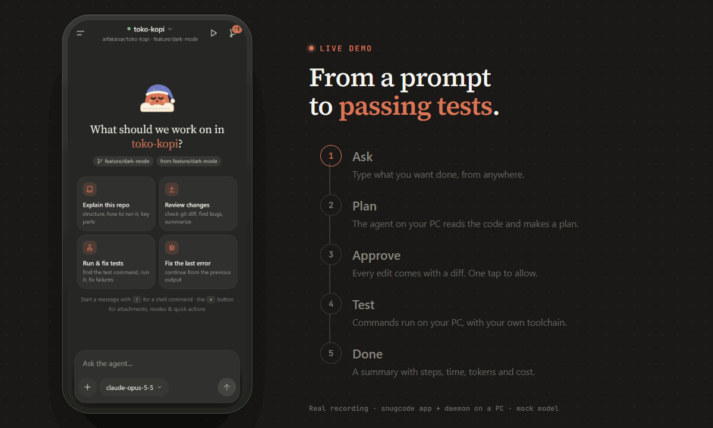

</td>
<td width="42%" valign="top">

### From prompt to passing tests

1. Type a request on your phone.
2. The agent on your PC reads the code and plans the change.
3. Before it edits a file, it shows you the diff and waits for your OK.
4. Tests run on **your** machine, with your toolchain.
5. Then you get a summary: steps, time, tokens, and cost.

<sub>A real screen recording: the app in Chromium, the snugcode daemon, and a mock model.</sub>

</td>
</tr>
</table>

---

## Get started in 2 minutes

**You need:** [Node.js 22+](https://nodejs.org), [git](https://git-scm.com), a GitHub account, and a ChatGPT account **or** any model API key.

**1. Install on your PC**

```bash
curl -fsSL https://snugcode.dev/install.sh | sh        # macOS / Linux
```
```powershell
irm https://snugcode.dev/install.ps1 | iex             # Windows (PowerShell)
```

Setup asks for a model key, a PC name, and a short PIN, then shows you one link that connects the PC to your GitHub account.

**2. Open the app on your phone**

Go to **[snugcode.dev/agent](https://snugcode.dev/agent/)**, sign in with GitHub, pick your PC, and enter the PIN (only the first time).
Tip: choose *Add to Home screen* so it opens like a normal app and can send notifications.

**3. Start a session**

Pick a repo and a branch, then type what you want done. That's it.

> **No PC that stays on?** The app can create a **cloud runner** in your own GitHub Codespaces, which is free within GitHub's monthly quota. Nothing has to be installed on a computer. See [No PC: cloud runner](docs/guide.md#no-pc-cloud-runner).

---

## What you can do

<table>
<tr>
<td width="33%" valign="top">

**🧠 Use any model**<br>
<sub>Sign in with ChatGPT, or paste a key from Anthropic, OpenAI, Gemini, OpenRouter, DeepSeek, or a router. snugcode detects the key type and runs each model in the harness built for it.</sub>

</td>
<td width="33%" valign="top">

**👆 Approve with one tap**<br>
<sub>Every edit comes with a colored diff, and risky commands are flagged. Choose *Allow*, *Always*, or *Deny*. You can even answer from the notification.</sub>

</td>
<td width="33%" valign="top">

**🌿 Safe for your repo**<br>
<sub>Each session works in its own git worktree and branch, and you can rewind to the state before any prompt. Your main branch stays untouched.</sub>

</td>
</tr>
<tr>
<td valign="top">

**▶️ Run & preview**<br>
<sub>Start your dev server from the phone, open a private preview link, and take screenshots. Console errors can go straight back to the agent.</sub>

</td>
<td valign="top">

**🔀 Git from anywhere**<br>
<sub>See status and per-file diffs, comment on lines, then commit, push, and open a Pull Request.</sub>

</td>
<td valign="top">

**💻 Same session in the terminal**<br>
<sub>Run `snugcode` at your desk and keep going on your phone later. It's the same session on both screens.</sub>

</td>
</tr>
</table>

<table>
<tr>
<td width="50%" align="center" valign="top">
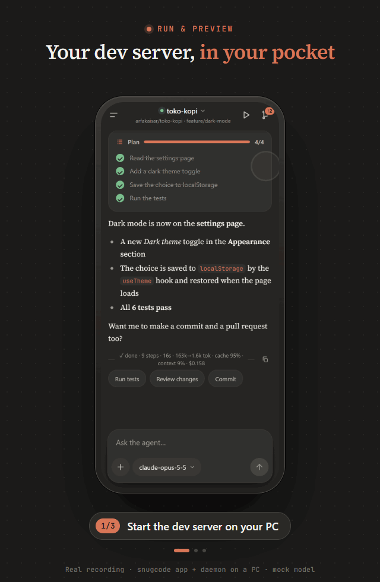<br>
<b>Run & Preview</b>
</td>
<td width="50%" align="center" valign="top">
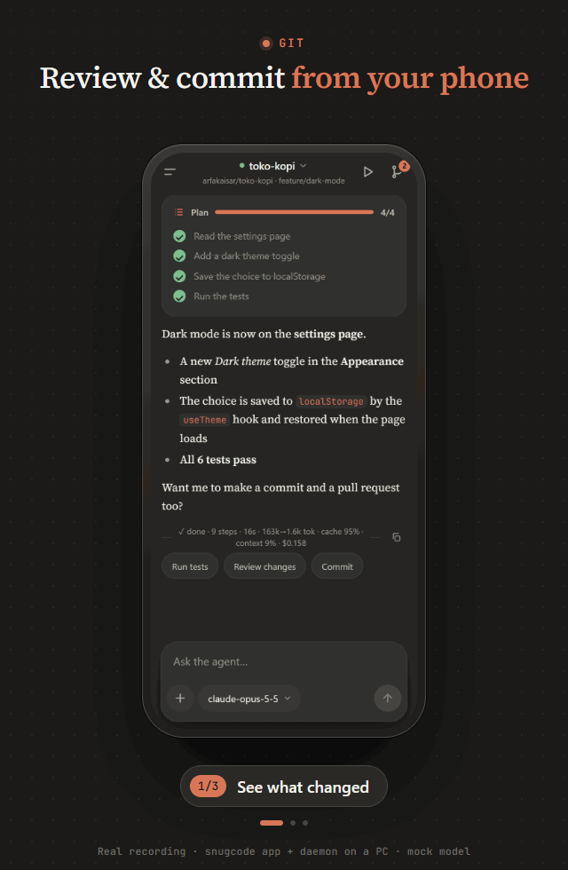<br>
<b>Git from your phone</b>
</td>
</tr>
</table>

<details>
<summary><b>More screenshots</b></summary>
<br>
<table>
<tr>
<td align="center" width="33%" valign="top">
<picture><source media="(prefers-color-scheme: light)" srcset="docs/images/sessions-light.jpg">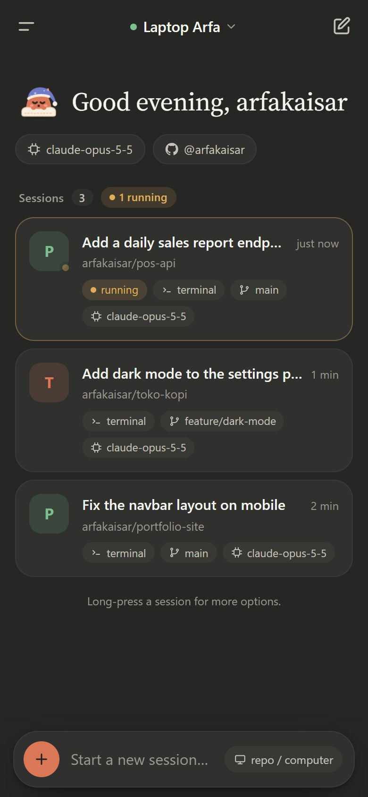</picture><br>
<b>Home</b>
</td>
<td align="center" width="33%" valign="top">
<picture><source media="(prefers-color-scheme: light)" srcset="docs/images/session-light.jpg">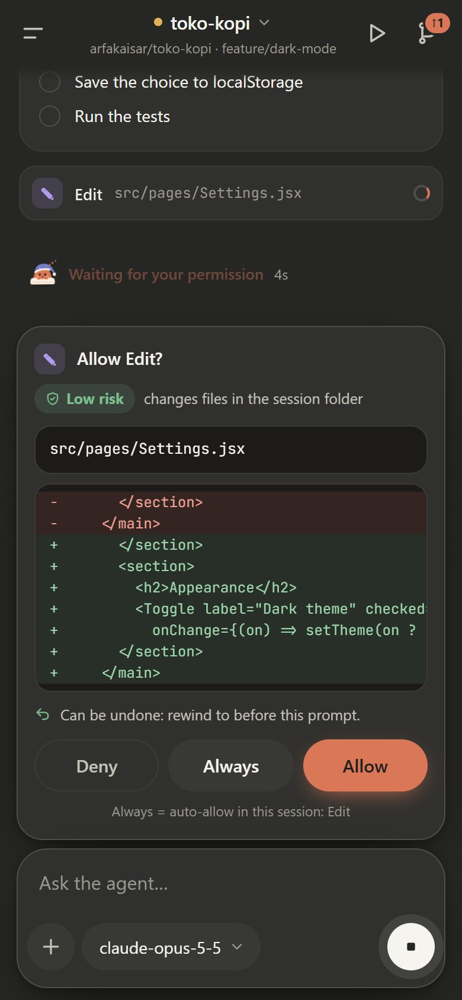</picture><br>
<b>Permissions with diffs</b>
</td>
<td align="center" width="33%" valign="top">
<picture><source media="(prefers-color-scheme: light)" srcset="docs/images/summary-light.jpg">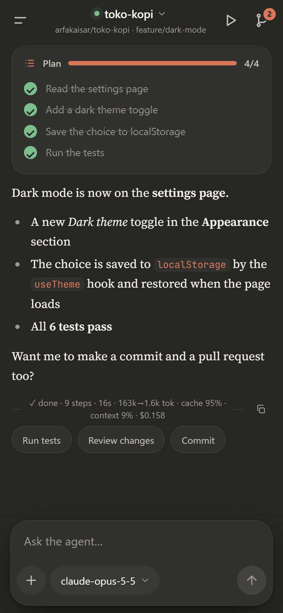</picture><br>
<b>Summary</b>
</td>
</tr>
<tr>
<td align="center" valign="top">
<picture><source media="(prefers-color-scheme: light)" srcset="docs/images/diff-light.jpg">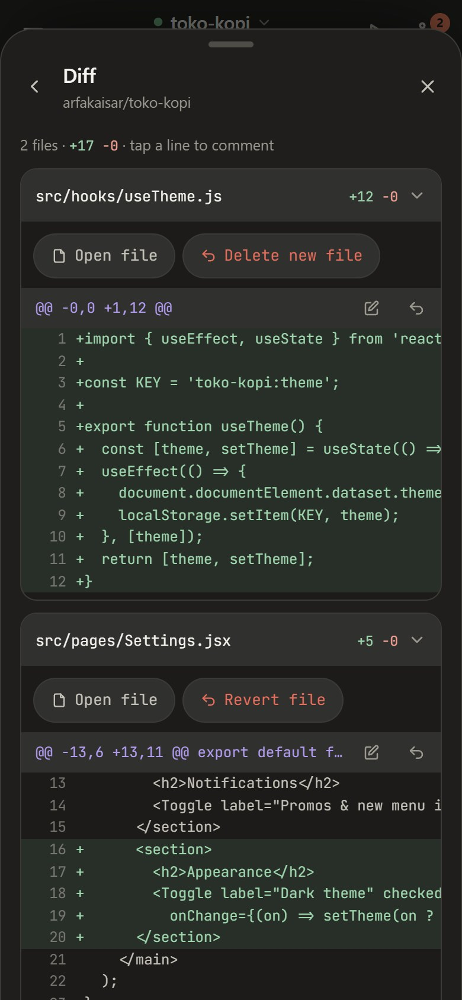</picture><br>
<b>Diff</b>
</td>
<td align="center" valign="top">
<picture><source media="(prefers-color-scheme: light)" srcset="docs/images/model-light.jpg">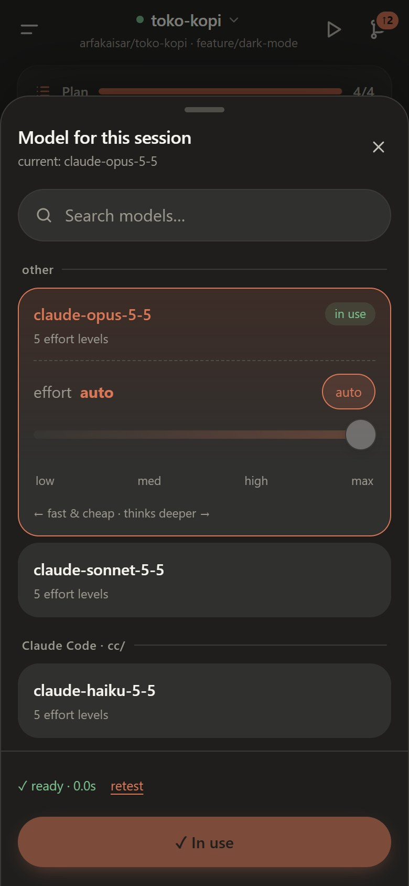</picture><br>
<b>Model & effort</b>
</td>
<td align="center" valign="top">
<picture><source media="(prefers-color-scheme: light)" srcset="docs/images/preview-light.jpg">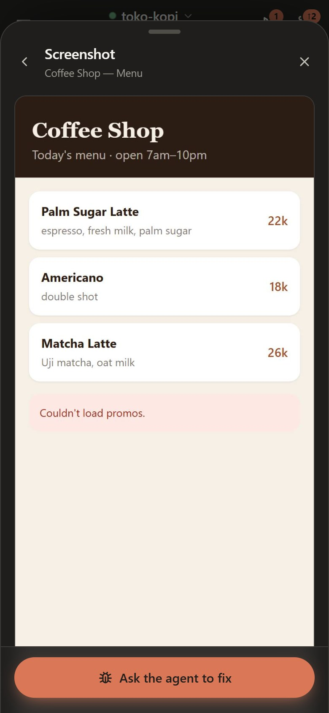</picture><br>
<b>Screenshot</b>
</td>
</tr>
</table>
<p align="center">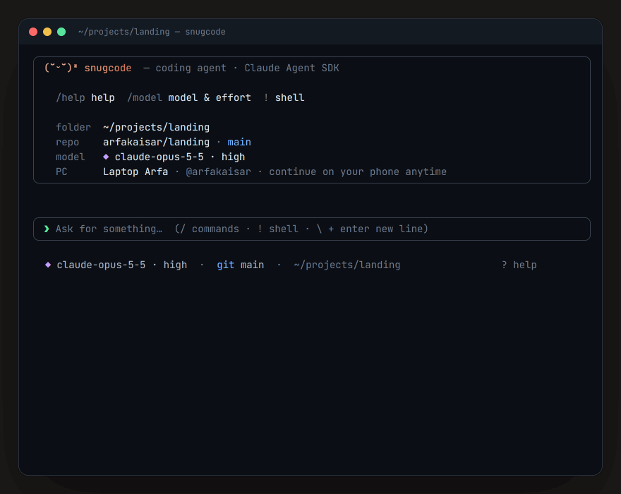<br><b>Terminal UI</b> · <code>snugcode</code></p>
</details>

The full feature list is in the **[user guide](docs/guide.md#features)**.

---

## How it works

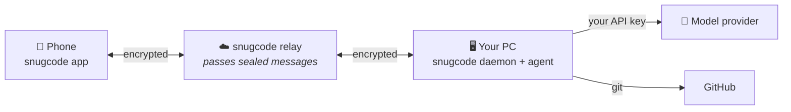

- The **daemon** on your PC connects *out* to the relay, so you don't need port forwarding, a VPN, or a public IP.
- The **phone** pairs with your PC once using a PIN. After that, every message is end-to-end encrypted.
- The **agent** works on your PC, and model traffic goes straight from your PC to the provider you chose.

## Private by design

- **Your code stays on your PC.** It never goes through snugcode's servers in readable form.
- **Your keys stay on your PC.** API keys, ChatGPT sign-in, and GitHub tokens are stored only in `~/.snugcode`. They are never sent back to the phone, and the agent itself can't read them.
- **The relay only sees sealed boxes.** Pairing uses a PAKE (CPace), and messages use XChaCha20-Poly1305.
- **You can check it.** The app the relay serves is a byte-for-byte build of this repo. [Here's how to verify it](docs/security.md#verifying-the-pwa-you-use).

Read the full, honest threat model in **[docs/security.md](docs/security.md)**, including what the relay *can* see.

---

## Open source, hosted service

snugcode is built in the open. The parts that touch your code, keys, and devices are all here for anyone to read and audit. The hosted service at snugcode.dev, which connects your phone to your PC, is run by us.

| In this repo (AGPL-3.0) | Run by snugcode.dev |
|---|---|
| The PC daemon, agent harnesses & terminal UI (`daemon/`) | Accounts & GitHub sign-in |
| The phone app (`web/`) | Linking PCs and routing encrypted messages |
| Encryption & protocol (`shared/`) | Cloud runner management, website |
| Cloud runner image (`.devcontainer/`, `Dockerfile`) | |
| A local dev relay for tests (`test/dev-relay.mjs`) | |

### Is it really free?

Yes. The app, the daemon, and the relay are free to use. You bring your own model (ChatGPT sign-in or an API key), and model usage is billed by your provider, not by us. Cloud runners use your own GitHub Codespaces quota. We're planning an optional paid tier, **snugcode Cloud**, with managed runners. Everything listed above stays free.

---

## Terminal

```bash
cd your-project
snugcode                       # open the terminal UI (or just: snug)
snugcode "explain this repo"   # start with a prompt
snugcode connect <api-key>     # add a model (type detected automatically)
snugcode autostart on          # keep the daemon running in the background
```

All commands and keyboard shortcuts are in the [user guide](docs/guide.md#terminal-snugcode).

---

## FAQ

<details>
<summary><b>Is my code sent to snugcode's servers?</b></summary>

No. Your code stays on your PC. Only end-to-end encrypted messages pass through the relay, and the relay can't read them. Code is sent only to the model provider you connect, the same as when you use any coding agent.
</details>

<details>
<summary><b>Which models can I use?</b></summary>

GPT models through ChatGPT sign-in (via the official Codex), plus anything you have a key for: Claude, OpenAI, Gemini, OpenRouter, DeepSeek, Kimi, GLM, xAI, Groq, or your own router or local endpoint. See [Models & API keys](docs/guide.md#models--api-keys).
</details>

<details>
<summary><b>Can I use my Claude Pro/Max subscription?</b></summary>

No. Anthropic doesn't allow third-party apps to use Claude subscriptions, so snugcode uses API keys for Claude. ChatGPT sign-in is allowed because it runs through OpenAI's official Codex.
</details>

<details>
<summary><b>Does it interfere with my own Claude Code or Codex setup?</b></summary>

No. snugcode keeps its own config folders inside `~/.snugcode`.
</details>

<details>
<summary><b>The phone keeps saying "Waiting for PC".</b></summary>

Check that the daemon is running (`snugcode status`, or `snugcode autostart on`) and that the PC isn't asleep. The log is at `~/.snugcode/daemon.log`.
</details>

More answers are in the [user guide](docs/guide.md#faq).

---

## Contributing

Bug reports, ideas, and pull requests are welcome. The whole client runs locally against a small dev relay, with no accounts needed. See **[CONTRIBUTING.md](CONTRIBUTING.md)** to get set up. Changes are listed in [CHANGELOG.md](CHANGELOG.md).

## License

The code in this repo is licensed under the **[GNU AGPL-3.0](LICENSE)**. You can use, study, change, and share it. If you run a modified version as a service for other people, you have to publish your changes under the same license.

"snugcode" and the snugcode logo are trademarks of the project. Forks are welcome, but they need their own name and logo. See [TRADEMARKS.md](TRADEMARKS.md).

<sub>Code published before October 24, 2026 was released under the MIT license, and those copies stay MIT.</sub>
