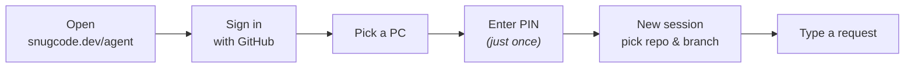
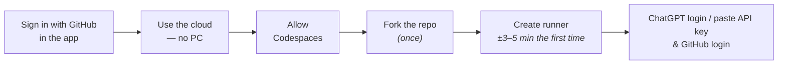
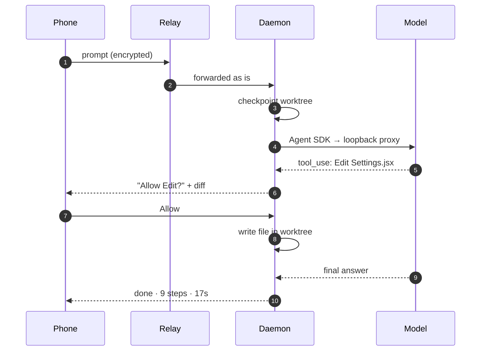
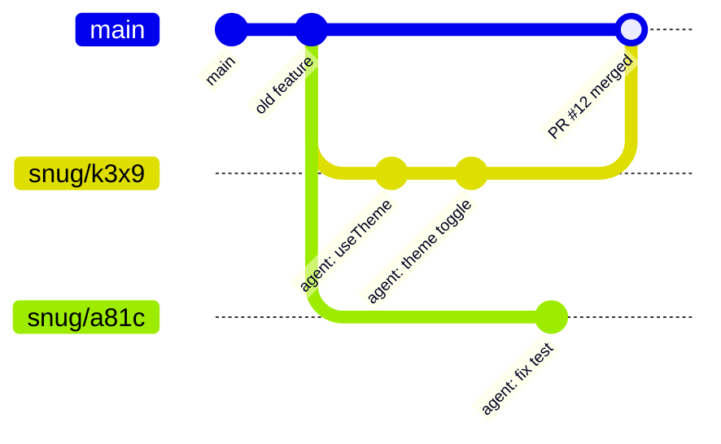
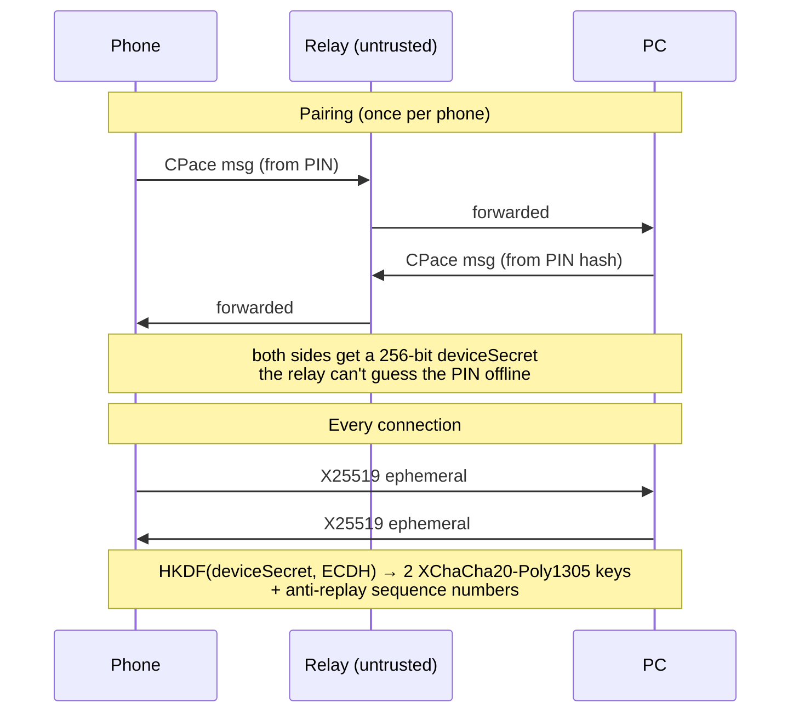

# snugcode user guide

Everything about using snugcode in one place. New here? Start with the [README](../README.md).

- [Install on your PC](#install-on-your-pc) · [Use it from your phone](#use-it-from-your-phone) · [No PC: cloud runner](#no-pc-cloud-runner)
- [Models & API keys](#models--api-keys) · [Terminal](#terminal-snugcode) · [All features](#features)
- [How it works](#how-it-works) · [Security](#security) · [Migrating from pocketcode](#migrating-from-pocketcode) · [FAQ](#faq)

## Install on your PC

**Requirements:** [Node.js 22+](https://nodejs.org), [git](https://git-scm.com), a GitHub account, and **a ChatGPT account or a model API key** (see [Models & API keys](#models--api-keys)).

Fastest way — the one-line installer checks Node.js & git, installs snugcode, then runs setup:

```bash
# macOS / Linux
curl -fsSL https://snugcode.dev/install.sh | sh
```

```powershell
# Windows (PowerShell)
irm https://snugcode.dev/install.ps1 | iex
```

The same commands are in the phone app (*Add PC* → copy), and the phone opens the new PC automatically as soon as setup finishes.
Or manually:

```bash
npm i -g github:arfakaisar/snugcode
snugcode setup
snugcode autostart on
```

`snugcode setup` asks for:

1. **Any API key** — its type is detected automatically; router keys (9router, OmniRoute, …) together with their URL — then the main model (the light subagent model is picked automatically). ChatGPT sign-in: `snugcode connect chatgpt` or from the phone.
2. **How to sign in to GitHub** for clone, push, and PRs. *Sign in via browser/phone* is recommended.
3. **PC name** and **PIN** (6–12 letters/digits, case-insensitive, e.g. `moon42`).
4. Then it shows **one link** (links the PC to your GitHub account) and **one code** (GitHub sign-in for the PC). Both can be opened from your phone.

`snugcode autostart on` starts the daemon in the background right away, and automatically every time you log in to Windows, macOS, or Linux.

> [!TIP]
> Without a global install: `npx github:arfakaisar/snugcode setup`, then `npx github:arfakaisar/snugcode start`.

> [!NOTE]
> The PC has to stay on while you use it from your phone. snugcode asks the OS not to sleep while the daemon runs, but if the PC still goes to sleep when idle, change the sleep settings: on Windows, Settings → System → Power → Sleep: *Never* (when plugged in).

---

## Use it from your phone



1. Open **https://snugcode.dev/agent/** in your phone's browser (or the **Open snugcode agent** button on the snugcode.dev landing page), then **Sign in with GitHub** (the same account you used for the PC setup).
2. Pick your PC, then enter the PIN.
3. Browser menu → **Add to Home screen**, so it opens full screen like an app and push notifications work (required on iOS).
4. Account → **Allow notifications**. Low/medium-risk permissions can be answered straight from the *Allow / Deny* buttons in the notification (Android & desktop); choose *Updates to send → Important only* if you only want to hear about permissions, questions, and finished tasks.

### Session screen controls

| Control | What it does |
|---|---|
| Menu button (top left) or swipe from the left edge | Drawer: new session, home, recent sessions, switch PC, account & theme |
| **Session title** | Session menu: branch/model details, git, run, **Files**, **Terminal**, switch model, save `.env`, delete session |
| *Play* icon (top right) | Run & Preview: dev server, logs, screenshot, preview link |
| *Branch* icon (top right) | Git: status, diff (comment per line/hunk → *Send to agent*, revert hunk/file), commit, push, Pull Request (badge = number of changed files) |
| **+** in the composer | Attachments & tools: camera, gallery, plan mode, shell mode, **agent autonomy**, quick actions & saved prompts |
| **Model name** in the composer | Switch model & effort mid-session (applies from the next message) |
| Mode pill above the input | The active mode (Plan / Shell / Auto-approve); tap to turn it off |
| `!` at the start of a message | Run it as a shell command |
| **rewind** under your message | Restore all files to before that prompt |
| Chips under the completion summary | One-tap next steps: run tests, review, commit |
| Session menu → **Cost & limit** | Session cost (estimated) and a cost limit: prompts are held once the limit is reached |
| Stop button | Stop the agent |
| Long-press a session (home) | Open / delete the session |
| Pull down (lists) | Refresh |

### Models & effort

- Effort variants that a router exposes as separate IDs (e.g. `ag/gemini-3.8-flash-low` / `-medium` / `-high`) are merged into **one model with an effort slider**.
- Claude models (`cc/claude-opus-5-5`, `cc/claude-sonnet-5-5`) get a virtual *auto · low · medium · high · max* slider.
- Switching model/effort mid-session takes effect in the same agent process (no restart).
- The **light model (subagents)** is picked automatically: a Claude main model (`cc/`) → Claude Haiku 5.5, then Gemini 3.8 Flash; other models (`ag/`, …) → Gemini 3.8 Flash, then Claude Haiku 5.5. If neither is on the router, subagents use the main model.
- The completion summary shows **cache %**: the share of input read from the prompt cache. A constant 0% means the provider/router doesn't cache, so every step is billed in full.
- Every selected model is **tested automatically** with one small message, to catch models that were discontinued but still reply "success".
- Only models that support tool calling are shown.

### Run & Preview

Tap the *play* icon at the top right → **Run**. Setup commands (`npm ci`, `pnpm install`, …) and dev commands (`npm run dev`, …) are detected automatically, or can be set per repo in `.snugcode.json`:

```json
{ "setup": "pnpm install", "dev": "pnpm dev --port {port}" }
```

The `PORT` env var is set to a free port, and `{port}` is replaced with the same port. **Preview on your phone** opens a Cloudflare quick tunnel to a local gate protected by a secret token (sent only over the E2EE channel). Without the token, the link is rejected. The tunnel closes automatically when the process stops.

> [!TIP]
> `.env` files aren't carried into new worktrees. Open the session menu → **Save .env as template**, and that file is restored automatically in every new session of the same repo.

### Computer mode

**New session** has two tabs: **Repository** (clone + isolated worktree, as above) and **Computer**. A Computer
session runs in any folder you choose (default: home `~`) with no clone, no worktree, and no new branch.
The agent may read and edit files anywhere on the PC, like plain `claude` in a terminal.

- Reading and editing files anywhere applies immediately; non-read-only Bash commands still ask for permission (unless auto-approve is on).
- **No checkpoints & rewind**, and `.env` templates aren't available. Git only shows status/diff when the working folder is a git repo.
- The `~/.snugcode` data folder stays closed to the agent, and `git push` / `gh pr create` always ask.
- Deleting a Computer session only deletes its history; files on the PC are not touched.
- From the terminal: `snugcode --computer` (or `-c`), or `/computer` inside the TUI.

> [!WARNING]
> Computer mode is deliberately not isolated. Use it for system tasks (tidying files, configuration, scripts across
> folders); for changing repo code, a Repository session is safer because it can be rewound.

---

## No PC: cloud runner

Don't have a PC that can stay on? Everything works from your phone: the **same** snugcode daemon runs in
**your own GitHub Codespaces**, and the app treats it like a regular PC. Nothing needs to be installed or typed
on any computer.



1. Sign in to the app → the empty screen shows **Use the cloud — no PC** (or *Add another PC* → *Create cloud runner*).
2. **Connect GitHub Codespaces** (`codespace` scope; the token is stored only on your phone, not on snugcode's servers).
3. Fork this repo once. The runner codespace is created from that fork.
4. **Create runner**: the app registers the machine, stores the machine token & a random PIN as *Codespaces secrets*
   **encrypted on the phone** (sealed box), then creates the codespace. The phone is paired right away without typing a PIN.
5. **Sign in with ChatGPT** or paste an **API key** (detected & tested before it is saved), then sign in to GitHub for clone/push — all from the phone.

While the runner is being prepared, the app shows the real stages from the codespace (preparing the machine → Chromium →
installing snugcode → starting) with an estimate of the time left. If the runner script fails, the error message and its
last log lines are sent to the phone, so you don't need to open the codespace terminal.

| | |
|---|---|
| **Cost** | GitHub's free quota: 120 core-hours/month for Free accounts (±60 hours of a 2-core runner), 180 for Pro. This month's estimated usage is shown in the runner menu (tracked by the runner itself; GitHub billing can't be read with the `codespace` scope). |
| **Faster** | Optional: set up a **prebuild** in your fork's Codespaces settings — new runners start in ±1 minute instead of 3–5. See [`.devcontainer/README.md`](../.devcontainer/README.md#prebuild-opsional-runner-baru-lebih-cepat). |
| **Stops by itself** | After 30 minutes idle (configurable from 15 minutes to 2 hours, or off) — no agent/command/dev server running and the app is not open. |
| **Wakes up again** | Automatically when you open the runner in the app (±30–60 seconds). Sessions, worktrees, and history stay in `/workspaces/.snugcode`. |
| **Features** | Same as a PC: agent, permissions, Run & Preview (Chromium installed), git/PRs, Web Push, remote updates. |
| **Limits** | One Codespaces runner from the wizard (can be *Recreated*), at most 3 cloud machines per account. |
| **Delete** | The ⋯ button in the machine list (also when offline/stuck): the codespace, secrets, and machine are all removed. |

Codespaces permission on the phone revoked or expired? The app offers **Reconnect GitHub Codespaces**; the runner
and its contents don't change.

**Your own server (Docker / VPS):** in the same wizard, *Your own server* generates a `docker build … && docker run …`
command complete with the machine token & PIN (see [`Dockerfile`](../Dockerfile)). For other providers, run `snugcode cloud`
with the env vars from [`daemon/runner.js`](../daemon/runner.js).

> [!NOTE]
> In cloud mode, your code and API keys live on the runner provider's machine (GitHub, or your server). Messages stay E2EE,
> and neither the PIN nor keys ever pass through the relay in readable form.

---

## Models & API keys

Open **PC settings → Models & API keys** in the app (or `snugcode connect` in the terminal), then pick one:

- **Sign in with ChatGPT** — a Plus/Pro subscription is used through the official **Codex** (OpenAI allows this for third-party harnesses). The sign-in code is shown on the phone; finish it in the browser.
- **Paste an API key** — its type is recognized from its shape and verified with the provider; unrecognized keys are treated as router keys and you are asked for the URL.

| Key / endpoint | Example | Harness used |
|---|---|---|
| Anthropic (Claude API) | `sk-ant-api03-…` | Claude Agent SDK, straight to `api.anthropic.com` (native prompt cache) |
| OpenAI | `sk-proj-…` | Codex (Responses API) |
| Google Gemini API | `AIza…` | Official **Gemini CLI** (ACP, native API format; installed automatically once). If Gemini CLI can't be installed: Claude Agent SDK + format translator in the proxy |
| OpenRouter | `sk-or-v1-…` | Claude Agent SDK through its Anthropic-format endpoint (or the translator) |
| DeepSeek · Kimi · GLM | `sk-…` · `….…` | Claude Agent SDK through their official Anthropic-format endpoints |
| xAI · Groq | `xai-…` · `gsk_…` | Claude Agent SDK + format translator |
| Router / your own endpoint (9router, OmniRoute, LiteLLM, Ollama, …) | key + URL | detected: Anthropic format → Claude Agent SDK; GPT models + Responses API → Codex; OpenAI Chat only → translator |

All connections show up together in the model picker (grouped per connection, with an effort slider when the model supports it). The same model can be used through several connections; the harness is chosen per model ([`shared/engine-table.js`](../shared/engine-table.js), then the endpoint format), and can be forced with the env var `SNUGCODE_ENGINE=claude|codex|gemini` (if the endpoint supports it).

**Measuring the best harness:** `npm run bench -- --models gemini:gemini-3.8-flash,openai:gpt-5.5` runs the same small coding tasks (fix a bug, add a feature, rename across files) on each engine for each model, grades them with tests, then prints a table of pass rate, time, and tokens along with a suggested `engine-table.js` row. It uses the connections & keys on this PC (tokens are billed to your key), in a temporary data folder.

> [!IMPORTANT]
> **Claude Pro/Max subscriptions** and **Gemini CLI / Antigravity sign-ins** may not be used by third-party apps (Anthropic & Google terms, 2026 — accounts can be blocked/suspended). snugcode rejects Claude subscription tokens and uses API keys. Routers that forward such subscriptions (e.g. the `cc/` or `ag/` providers in 9router) can still be connected, but the risk is on your account.

```bash
snugcode connect sk-ant-api03-…              # any API key, type detected
snugcode connect rk-… --url https://router.example.com/v1   # router / your own endpoint
snugcode connect chatgpt                     # ChatGPT sign-in (Codex), the code can be opened on your phone
snugcode connect                             # list connections;  snugcode disconnect <id>
```

Cloud/Docker runners: `SNUGCODE_API_KEY` (+ `SNUGCODE_API_URL` for routers) connects a model at startup.

---

## Terminal: `snugcode`

```bash
cd your-project
snugcode                     # or for short: snug
snugcode "explain this repo" # send a prompt right away
snugcode --pick              # pick another session (including sessions from the phone)
snugcode --computer          # Computer mode session in this folder (access to the whole PC)
```

- The git repo folder where you run `snugcode` becomes the session directly, without cloning. The last session in that folder is resumed automatically.
- **Terminal and phone sessions are the same sessions.** Sessions from the terminal are marked "terminal" in the phone app.
- The daemon is started automatically if it isn't running.

| Key | What it does |
|---|---|
| `enter` | send; while the agent is working, the message is queued |
| `\` + `enter` / `alt+enter` | new line |
| `!` | shell mode (commands run directly in the session folder) |
| `/` | commands: `/model` `/default` `/sessions` `/new` `/computer` `/run` `/preview` `/logs` `/plan` `/rewind` `/git` `/diff` `/commit` `/push` `/pr` `/auto` `/edits` `/login` `/update` `/clean` `/help` … |
| `esc` | stop the agent |
| `ctrl+o` | full output of the last tool |
| `ctrl+c` ×2 | quit (the session keeps running on the PC) |

In `/model`, use ↑↓ to pick a model and ←→ to set the effort.

### CLI commands

| Command | What it does |
|---|---|
| `snugcode` / `snug` | Terminal UI |
| `snugcode --computer` / `-c` | Terminal UI with a Computer mode session |
| `snugcode setup` | Set up / change configuration |
| `snugcode login` | Sign in to GitHub again (only) |
| `snugcode connect <key> [--url URL]` | Connect a model API key (type detected automatically) |
| `snugcode connect chatgpt` | Sign in with ChatGPT for GPT models (Codex) |
| `snugcode connect` / `disconnect <id>` | List / remove model connections |
| `snugcode start` | Run the daemon in this terminal |
| `snugcode stop` / `restart` | Stop / restart the background daemon |
| `snugcode update` | Check for and install updates (tagged releases; `--channel main` for the latest commit) |
| `snugcode update --rollback` | Go back to the version before the last update |
| `snugcode autostart on\|off` | Run in the background + automatically at login |
| `snugcode clean` | Scan & clean up orphaned worktrees / repos |
| `snugcode pin` | Change the PIN and unlock pairing right away (then `snugcode restart`) |
| `snugcode devices` | List paired phones |
| `snugcode revoke <id\|all>` | Revoke a phone's access (then `snugcode restart`; from the phone it applies immediately) |
| `snugcode status` | Configuration summary |
| `snugcode keychain on\|off\|status` | Encrypt `secrets.json` with a key in the OS keychain (macOS Keychain, Secret Service, DPAPI) |
| `snugcode cloud` | Cloud runner without a PC (Codespaces/Docker): configuration from env, other settings from the phone |
| `snugcode help` | List of commands |

Models & API keys, the PIN, and devices can also be managed from the phone: **PC settings → Models & access**.

<details>
<summary><b>Where data lives on the PC</b></summary>

All data is stored in `~/.snugcode` (can be changed with the `SNUGCODE_HOME` env var). Older installs that already have `~/.pocketcode` keep using that folder:

```
~/.snugcode/
├── config.json          # PC name, relay, default model, …
├── secrets.json         # model connections (API keys), GitHub token, PIN (hash), phone device secrets (encrypted with `snugcode keychain on`)
├── daemon.log           # background daemon log (daemon.pid, daemon.sock: process & terminal channel)
├── workspaces/
│   └── <owner>__<repo>/
│       ├── _base/       # base clone (kept 3 days after its last session is deleted)
│       └── s-<id>/      # one worktree per session
├── sessions/            # index.json + per-session event history (JSONL)
├── env/                 # .env templates per repo
├── bin/                 # cloudflared (downloaded automatically), pnpm/yarn shims in bin/pm
├── tools/               # corepack, Codex, Gemini CLI (each installed once, when first needed)
├── claude/              # CLAUDE_CONFIG_DIR of the Claude engine, separate from your personal Claude Code (including plans/)
├── codex/               # CODEX_HOME of the Codex engine: ChatGPT sign-in & thread history (Codex is installed in tools/codex)
└── gemini/              # GEMINI_CLI_HOME of the Gemini CLI engine (repo/ & computer/): settings, instructions, session history
```

On Codespaces runners this folder is `/workspaces/.snugcode` (it survives the codespace stopping), plus
`cloud.log`, `install.log`, and `runner-usage.json` (estimated core-hours). In a Docker container: the `/data` volume.
</details>

---

## Features

<table>
<tr>
<td width="50%" valign="top">

#### Agent & collaboration

- **Best harness per model** — Claude models and Anthropic/OpenAI-format endpoints run on the **Claude Agent SDK**, GPT models (ChatGPT login / OpenAI) on the official **Codex**, and Gemini models (Google AI API key) on the official **Gemini CLI**. The defaults can be re-measured with `npm run bench`. See [Models & API keys](#models--api-keys).
- **Paste any API key** — Anthropic, OpenAI, Gemini, OpenRouter, DeepSeek, Kimi, GLM, xAI, Groq, or a router (9router, OmniRoute, LiteLLM, local); the type and format are detected automatically. The agent configuration is trimmed down: every request is ±55% smaller.
- **Frugal subagents** — Explore, Plan, and others automatically use a light model from the same connection (**Claude Haiku**, **Gemini Flash**, …) at low effort.
- **1-tap permissions** — *Allow / Always / Deny*. *Always* applies per command pattern (e.g. `npm test *`), not to all of Bash.
- **Edits apply immediately** in the session worktree and can be rewound. Turn on *Review edits* (`/edits`) to approve every diff.
- **Auto-approve** for autonomous work; `git push` and `gh pr create` always ask.
- **Plan mode** — the agent reads, then proposes a plan for you to approve or revise.
- **The agent can ask questions** — multiple-choice questions are answered with a single tap.
- **Send images** from the camera or gallery (up to 4 per message).
- **Checkpoints & rewind** to the state before any prompt.
- **Per-hunk diff review** — comment on lines or hunks and send them as one message to the agent, or revert a single hunk/file.
- **Direct shell** — `!npm test`, `!git status`, with output streamed to the phone.
- **Computer mode** — a session with no repo/worktree that can read, edit, and run commands across the whole PC, like plain `claude`. See [Computer mode](#computer-mode).

</td>
<td width="50%" valign="top">

#### Run & Preview

- **Background dev servers** — setup/dev commands are detected automatically (npm / pnpm / yarn / …), with live logs and port detection.
- **Preview on your phone** through a private token-protected tunnel; Vite/Next HMR keeps working.
- **Screenshots + console errors** from headless Chrome/Edge on your PC, then *Ask the agent to fix it*.
- **Interactive terminal** (PTY) on the phone — `vim`, `htop`, REPLs, login prompts; an Esc/Tab/Ctrl/arrow key row and up to 4 tabs per session. The shell stays alive when the screen is closed.
- **File explorer** — browse the worktree, read & edit files (with conflict detection), create new files, *Ask the agent* about a file.
- The agent can **see the UI it built** (`dev_start`, `preview_screenshot`) to verify its work.

#### Git & GitHub

- Clone your GitHub repos to your PC, one worktree and branch per session.
- Status, diff, commit, push, and **Pull Requests** from your phone.

#### System

- **Web Push** when the agent finishes, needs permission, or asks a question — even when the PWA is closed.
- **Anti-sleep** while the daemon runs on your PC (Away Mode / `caffeinate` / `systemd-inhibit`).
- **1-tap remote updates** from the phone, with a banner when a new version is available.
- **PC settings from the phone** — models & API keys, ChatGPT login, paired devices, PIN, and GitHub login, no terminal needed.
- **Clear progress** for long operations (creating a runner, updating, cloning, pushing): stage, elapsed time, and estimated time left.
- **Model picker** with an effort slider (`low → max`) and automatic model health checks.
- **Dark & light themes**, following the system or chosen manually.

</td>
</tr>
</table>

---

## How it works

1. The **daemon** runs in the background on your PC (automatically at login) and opens an *outbound* WebSocket to the relay.
2. The **phone** opens the PWA, signs in with GitHub, and pairs with the PC using a **PIN** (once).
3. Every prompt from the phone is sent encrypted to the PC, where the right harness for the model (**Claude Agent SDK** or **Codex**) works on it in the session worktree.
4. Agent events (text, tools, permission requests) are streamed back to the phone **and** the terminal in real time.

<details>
<summary><b>The flow of one prompt</b></summary>


</details>

<details>
<summary><b>Session isolation with git worktrees</b></summary>



Every session gets the folder `~/.snugcode/workspaces/<owner>__<repo>/s-<id>` with its own branch (default `snug/<id>`). Several sessions can run in parallel on the same repo without getting in each other's way.
</details>

---

## Security



- **The relay can't read messages** — the PIN, conversations, code, API keys, ChatGPT sign-in, and GitHub tokens never pass through the relay in readable form. Model traffic goes straight from your machine to the provider. **Important limit:** the relay also serves the PWA code, so whoever controls the relay deployment could replace that code. Read [docs/security.md](security.md) for the full threat model, what the hosted relay can and can't see, and how to verify the PWA build (`build.json`).
- **Brute force is limited** — after 5 wrong PINs, pairing locks for 15 minutes (doubling with each subsequent lock, up to ±16 hours). `snugcode pin` on the PC or Change PIN from another phone unlocks it immediately.
- **Relay sign-ins can be revoked** — Account → *Sign out of all devices* revokes the sign-in token on every phone & browser (e.g. a lost phone). Linking a PC via a link always asks for confirmation after the GitHub sign-in (the PC name, code, and account are shown; confirmation is a token-protected POST and can't be bypassed with URL parameters). Sign-ins in regular use are renewed automatically.
- **PWA with a strict CSP** — no inline scripts or third-party scripts/fonts (fonts are self-hosted), and WebSockets only to its own relay, so tokens & device secrets on the phone are harder to steal through XSS. The sign-in token is sent through the WebSocket subprotocol, not the URL (so it isn't logged).
- **Risk-graded permission cards** — every request is labeled low/medium/high risk with a reason; high risk (deleting data, scripts from the internet, push, leaving the session folder) is shown in red without an *Always* button, and can't be answered from notification buttons.
- **Graded autonomy** — *Ask everything*, *Balanced* (default), *Routine auto* (tests/lint/builds without command chains pass on their own), *Full* (auto-approve). Push, PRs, and credential files always ask at every level.
- **Downloaded binaries are verified** — Codex & Gemini CLI are version-pinned; `cloudflared` is pinned to a version + official SHA-256 ([`daemon/cloudflared-version.json`](../daemon/cloudflared-version.json)).
- **The GitHub token** is injected via env only into the daemon's own git commands. It isn't written to `.git/config` and isn't visible to the agent. `GITHUB_TOKEN`/`GH_TOKEN` already in the environment (e.g. from Codespaces) are dropped when the daemon starts, so they aren't inherited by the agent, Bash, dev servers, or `!commands`.
- **Settings from the phone** — models & API keys, ChatGPT sign-in, the PIN, and the phone list can be managed from the app (PC settings). Keys are sent over the E2EE channel, validated against their endpoint first, and never returned to the client.
- **API keys never enter the agent process.** The `claude` / Codex processes (and agent commands) only hold a random local token per connection; the loopback proxy (`127.0.0.1`) swaps it for the real key. Requests without that token are rejected, so other programs on the PC can't use your key.
- **`~/.snugcode` is closed to the agent** — Read/Write/Edit/Glob/Grep on the data folder (keys, tokens, device secrets, `.env` templates) are always denied, including under auto-approve. The only exceptions are the session worktree and the agent's own Claude config folder. Bash commands that mention `secrets.json` always ask.
- **OS sandbox for auto-approve (Claude engine)** — while ⚡ auto-approve is on, the agent's Bash runs in Claude Code's sandbox (bubblewrap + socat on Linux, Seatbelt on macOS), which refuses to read the snugcode data folder or write git hooks/config; the worktree, package caches, and the network still work. Commands that ask to leave the sandbox always ask. The PC's `localhost` isn't reachable from inside the sandbox (use `dev_*`/Preview for dev servers). Configure with `"sandbox": "auto" | "always" | "off"` in `config.json` (or `SNUGCODE_SANDBOX`). If bubblewrap/socat aren't installed (`sudo apt install bubblewrap socat`) or on Windows, the session tells you that auto-approve runs without a sandbox.
- **Only safe things run without asking** — read tools pass automatically only inside the session worktree. Reading outside the worktree and `WebFetch` ask for permission (or auto-approve), so prompt injection from a README/issue can't quietly send files out.
- **OS sandbox for the Codex engine** — Codex agent commands run in a sandbox (bubblewrap/Seatbelt) that refuses to read the snugcode data folder (`secrets.json`, ChatGPT sign-in, `.env` templates, history); the network is still allowed. Every command still goes through the same snugcode permission policy. If an OS sandbox isn't available (containers without user namespaces), the app tells you and permissions still apply.
- **Remote actions** (`git push`, `gh pr create|merge`, `gh repo create|delete`, …) always ask for permission, even with auto-approve on.
- **Computer mode** relaxes the worktree boundary: reading & editing anywhere on the PC passes without asking (non-read-only Bash still asks). The snugcode data folder and remote actions stay guarded as above.

- **Tool configuration from the repo isn't trusted** — the repo's `.claude/settings.json` (hooks, permission rules, env, `apiKeyHelper`) is **not** loaded; only `CLAUDE.md` (and `.claude/CLAUDE.md`) are read as project instructions. Changing `.claude/`, `.codex/`, `.gemini/`, `.mcp.json`, or the contents of `.git/` always asks, even under auto-approve, so prompt injection can't quietly install hooks.
- **Gemini CLI engine** — the working folder is never marked trusted, so the repo's `.gemini/settings.json` (MCP servers, hooks, `discoveryCommand`) isn't run; `GEMINI.md`/`AGENTS.md`/`CLAUDE.md` are injected by snugcode as instructions. Gemini CLI has no OS sandbox on Linux/Windows, so **shell commands still ask even with auto-approve on**; file edits go through snugcode (data folder denied, waits for the checkpoint).
- **Encrypted `secrets.json` (optional)** — `snugcode keychain on` encrypts its contents (XChaCha20-Poly1305) with a key that only exists in the OS keychain. Backups, cloud sync, or a borrowed disk don't expose your API keys & tokens. This is protection at rest: processes of the same user that are allowed to open the keychain still can, so the agent's boundary remains the permission policy & sandbox.
- **File explorer & terminal from the phone** — only inside the session folder (the snugcode data folder is denied, symlinks leading outside are hidden); saving a file that changed on the PC is rejected (hash conflict). The PTY terminal runs as the PC user without a sandbox — the same as opening a terminal on that PC, just over the E2EE channel.

> [!WARNING]
> Push command detection is based on text patterns: it is a safeguard against agent mistakes, not a sandbox. Outside auto-approve, Bash runs without a sandbox once you approve it — read the command before allowing it.

---

## Migrating from pocketcode

snugcode is the new name of pocketcode. The protocol, data, and pairing are unchanged:

- The **data folder** `~/.pocketcode` keeps being used if it already exists (phone pairing, sessions, worktrees, agent history). New installs use `~/.snugcode`.
- The **app address** is now `https://snugcode.dev/agent/` (the landing page lives at `https://snugcode.dev`): the `snugcode` alias worker serves the site and forwards the API & WebSockets to the old relay worker through a service binding, so accounts, linked PCs, and data don't change. PCs still using the old URL stay connected. On the old address, the PWA offers **Move now** (sign-in, PC pairing, and theme come along, with no new sign-in/PIN) and the sign-in page redirects to the new address. Apps installed on the home screen before the move to `/agent/` are forwarded there automatically.
- `POCKETCODE_*` env vars, `.pocketcode.json` files, and old autostart entries are still recognized; old autostart entries are migrated automatically.

Remote updates from an old daemon version **can't** switch to the new package by themselves, so each PC needs to be migrated once. The phone app shows a **"Move this PC to snugcode"** banner that can run it through a session, or run it yourself in the PC terminal:

```bash
# macOS / Linux
npm i -g github:arfakaisar/snugcode --include=optional && { pocketcode stop; npm rm -g pocketcode; snugcode autostart on; }
```

```powershell
# Windows (PowerShell)
npm i -g github:arfakaisar/snugcode --include=optional; if ($?) { pocketcode stop; npm rm -g pocketcode; snugcode autostart on }
```

> [!NOTE]
> The GitHub repo is now named `arfakaisar/snugcode`. GitHub redirects the old `arfakaisar/pocketcode` URL, so `git push` and updates from PCs that haven't been migrated keep working.

---

## FAQ

<details>
<summary><b>Is my code sent to snugcode's servers?</b></summary>

No. Your code stays on your PC. Only end-to-end encrypted messages that the relay can't read pass through it. Code is only sent to the AI model provider you connect, as context for the agent, just like using a coding agent in the terminal.
</details>

<details>
<summary><b>The phone keeps saying "Waiting for PC".</b></summary>

Make sure the daemon is running (`snugcode status`, or `snugcode autostart on`) and the PC isn't asleep. The log is at `~/.snugcode/daemon.log`. The page on the phone connects automatically as soon as the PC is online.
</details>

<details>
<summary><b>My PIN is locked.</b></summary>

Run `snugcode pin` on the PC to change the PIN and unlock it, then `snugcode restart`. If another phone is already paired, you can also do it from there: PC settings → Change PIN (takes effect immediately).
</details>

<details>
<summary><b>Can I use several PCs or several phones?</b></summary>

Yes. One GitHub account can link many PCs, and every PC can be paired with many phones. List or revoke phones with `snugcode devices` / `snugcode revoke`.
</details>

<details>
<summary><b>Does it interfere with my personal Claude Code install?</b></summary>

No. snugcode uses its own `CLAUDE_CONFIG_DIR` in `~/.snugcode/claude` and its own `CODEX_HOME` in `~/.snugcode/codex`.
</details>

<details>
<summary><b>Can I use it without a PC at all?</b></summary>

Yes — see [No PC: cloud runner](#no-pc-cloud-runner). The runner runs in your own GitHub Codespaces (or a Docker server) and is managed entirely from your phone. Runner log: `/workspaces/.snugcode/cloud.log` (runner menu → *Open codespace on GitHub*).
</details>

<details>
<summary><b>Screenshots/preview don't work.</b></summary>

Screenshots need Chrome, Edge, Chromium, or Brave on the PC (or set `browserExecutable` in `~/.snugcode/config.json`). Preview uses `cloudflared`, which is downloaded automatically to `~/.snugcode/bin`.
</details>
